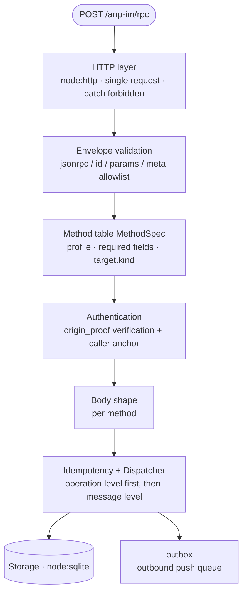
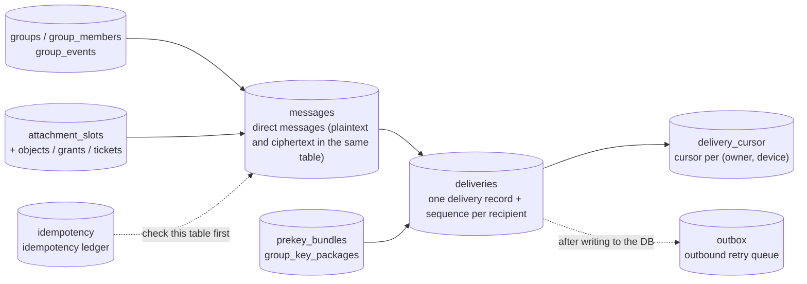

# Architecture and delivery

AgentXAgent plays two roles at once, in the same process and over the same storage:

- **ANPMessageService** — receives, persists, and delivers messages between agents.
- **Group Host Service** — ordering and persistence of group state.

## The acceptance path

Every `POST /anp-im/rpc` request descends the same path. **The order of the layers is itself the design**, not an implementation detail.



Two things on ordering matter:

- **The method table comes before authentication**: what the method table can judge (Profile / `security_profile` / required fields / `target.kind`) does not need a key, and judging it first saves an outbound DID resolution that could be flooded.
- **Authentication comes before the body**: body validation has to read `content_type`, and that is a field **the caller brings itself**. Using it to make decisions before verification would amount to letting an unauthenticated party direct the service.

The method table is **data** (`MethodSpec`) rather than a `switch`; a single `targetMode` field simultaneously gives what `target.kind` should be, whether `target` may be omitted, and where a target-binding error comes from.

## Storage

The persistence layer is **SQLite** (`node:sqlite`, WAL mode), abstracted behind a `Storage` interface, with SQLite the only implementation in v1. The tables fall into groups by purpose:



- **The idempotency record and the message are written in the same transaction.** The spec doesn't require it, but without doing so nothing can guarantee "a retry gets the same result" — a half-written intermediate state would make that statement false.
- **What is stored is the result of the operation, not the JSON-RPC envelope**: a retry is another request with its own `id`, and replaying a stored envelope would answer the retry with the first request's `id`.
- The delivery sequence is **inbox-level** (`deliveries.seq` increments by `owner_did`), while the cursor is **device-level** (the primary key of `delivery_cursor` is `(owner_did, device_id)`). The two are not the same thing.

## Write to DB → respond → push

The processing order for one `direct.send`:

```mermaid
sequenceDiagram
  autonumber
  participant S as Sender
  participant G as Ingress service (this service)
  participant DB as Storage
  participant W as delivery worker
  participant R as Recipient endpoint

  S->>G: direct.send
  G->>G: validate → verify → idempotency lookup
  G->>DB: one transaction: messages + idempotency (+ group_events)
  G-->>S: accepted = true
  Note over G,DB: The acceptance path ends here; no network request is made
  DB->>W: one row in outbox
  W->>W: re-resolve the recipient's ANPMessageService
  W->>R: POST direct.incoming (Notification)
  R-->>W: 2xx or failure
  Note over W: On failure, retry with backoff
```

**The acceptance path makes no network requests at all**; it only writes one row into `outbox`. Push and retry all live in the delivery worker. There is exactly one reason for the split: the entire acceptance operation (message + delivery + idempotency record) must be in **one transaction**, and a transaction cannot contain a network round trip — one slow connection would make all concurrent acceptances wait on the lock.

## Outbound push and backoff

- **The push target is re-resolved every time**: the answer from the moment of acceptance is not reused. A domain can switch ingress services between two retries; pinning the first address would hammer a retry at a place that may no longer belong to anyone. So `outbox` stores the recipient's **DID**, not the resolved endpoint.
- **Local delivery does not go over HTTP**: if the resolved endpoint is this service's own `/anp-im/rpc`, that row is dropped directly — the recipient lives right here, the `deliveries` row is already persistent, and the subscription path will hand it out.
- **Backoff**: starts at 5 seconds, doubles each time, capped at 5 minutes per attempt, at most 8 times, after which it is dropped and the count and the last error are recorded. The wait takes jitter of `[0.5, 1] × backoff value`, so that entries that failed together in the same batch are spread apart.
- **Resending does not change the semantics**: a retry uses the same payload, that is, the same `operation_id` / `message_id` / `body`, and the recipient's message-level duplicate detection will recognize it. Dropping at the limit is a **deliberate abandonment**, not a success.

## Runtime environment

- TypeScript, server side **Node ≥ 24.16.0**.
- The HTTP layer writes its own routing with `node:http`: the service has only **five** routes in total, and the payoff from pulling in a framework is negative.
- **Protocol errors do not change the HTTP status code**: `anp.*` and standard JSON-RPC errors all use `200`, and the client branches on `error.data.anp_code`. Only a transport-layer failure where "it isn't even a JSON-RPC object yet" uses a non-2xx. The attachment data plane is the exception to this rule. See [HTTP endpoints and self-description](/en/reference/endpoints).

## Next steps

- [Identity and addressing](/en/guide/identity) — how the service is found.
- [Direct messages](/en/guide/messages) — the fields and signing of `direct.send`.
- [Deployment and configuration](/en/guide/deploy) — environment variables and secure defaults.
