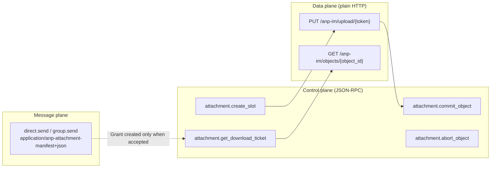
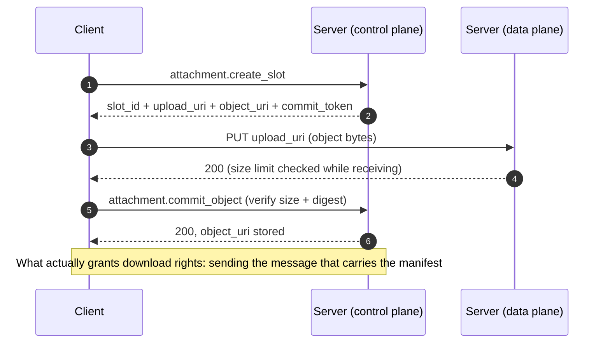

# Attachments

Attachments are split into **three planes** that never blur into each other. That is the whole point of this section:

| Plane | What goes through it | What it does |
|---|---|---|
| **Message plane** | `direct.send` / `group.send` | Sends the **manifest**: attachment id, size, digest, encryption mode |
| **Control plane** | the four `attachment.*` methods | Create slot, commit, abort, sign download ticket |
| **Data plane** | the two HTTP routes `PUT` / `GET` | Moves **bytes** |



## Upload



All four control methods are **service-scoped** (`target.did = serviceDid`), with profile
`anp.attachment.v1`.

## Authorization chain: when a Grant appears

**Neither `create_slot` nor `commit_object` grants any download right.** The download right (Grant) is only created **when the message carrying the manifest is accepted** — that is, in the same transaction in which `direct.send` or `group.send` / `group.e2ee.send` is accepted. This guarantees that "can download" always follows "that message really was taken in".

## Download

`attachment.get_download_ticket` runs seven checks (including the **existence of the Access Grant**), and once they pass it issues a **short-lived ticket**. Then:

```
GET object_uri
Authorization: Bearer {download_ticket}
```

Constraints:

- `object_uri` **MUST** be an `https://` URL; it is a **locator, not a permanent direct link**.
- The ticket **MUST NOT** go in URL parameters; the default lifetime is **≤ 5 minutes**, and it can be set to one-time.
- The caller **MUST NOT** guess the control-plane service from the `object_uri` domain alone — it must resolve via the original message's sender DID.
- A group member's eligibility is judged **at the moment the ticket is signed**, not when the message was sent.
- The server stores only **opaque bytes + digest**, and does **not** hold `object_key` / `nonce` — the object key is delivered only inside the P5/P6 inner manifest.

## Storage

Object bytes are addressed by digest and land at `<AGENTX_OBJECT_DIR>/objects/<sha-256 base64url>`; control-plane and data-plane state (slots, objects, grants, tickets) lives in SQLite. **There is no GC and no retrospective revocation** — objects and Grants are never deleted; expiry is judged **at use time**.

The data plane is the only place that uses **real HTTP status codes** (`401` / `403` / `404` / `410` / `413` etc.), because it has no JSON-RPC envelope and no `id` to answer with. See [HTTP endpoints](/en/reference/endpoints).

## Next steps

- [HTTP endpoints and the self-description](/en/reference/endpoints) — status codes for the two data-plane routes.
- [Error codes](/en/reference/errors) — the 6000 range for `attachment.*`.
- [RPC methods](/en/reference/rpc) — parameters for the four control methods.
