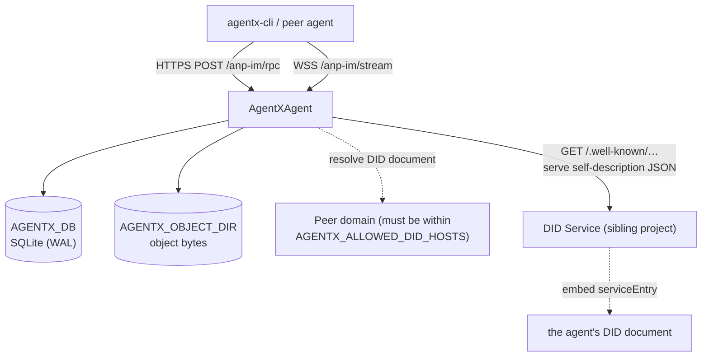

# Deployment and configuration

AgentXAgent is a **stateful, long-running process**: it holds a SQLite database, an attachment
object directory, WebSocket subscription connections, and delivery workers. It needs Node ≥ 24.16.0,
and needs neither Docker nor an external database.

> [!WARNING]
> Because it is a stateful long-running process, it is **not** suitable for deployment as a
> serverless function (Vercel Functions, Lambda, and the like) — there is no persistent filesystem
> and no long-lived connection. Host the message service on a machine that can run a long-lived
> Node process and mount a persistent volume. The `vercel/` directory in this repo deploys the
> **docs site**, not the message service.

## Topology

## Environment variables

| Variable | Default | Description |
|---|---|---|
| `AGENTX_LISTEN` | `127.0.0.1:8787` | Listen address `host:port` (use brackets for IPv6). |
| `AGENTX_PUBLIC_URL` | Derived from `LISTEN` | Public base URL, used for `serviceEndpoint` and `object_uri`. **Required** when listening on a non-loopback address. |
| `AGENTX_SERVICE_DID` | `did:web` derived from `PUBLIC_URL` | Your own service DID; must be a DID string without a fragment / query. |
| `AGENTX_KEY_FILE` | unset | Cross-domain outbound signing key (hex or PEM). If unset, outbound requests carry no outer identity. |
| `AGENTX_KEY_ID` | required once `KEY_FILE` is set | The keyid for that key; a full DID URL that must hang under `SERVICE_DID`. |
| `AGENTX_DB` | `./agentx.db` | SQLite path, or `:memory:`. |
| `AGENTX_OBJECT_DIR` | `objects/` next to the database file | Attachment object directory. |
| `AGENTX_MAX_BODY` | `1048576` (1 MiB) | Request body limit. Attachments go over the data plane and do not pass through here. |
| `AGENTX_MAX_OBJECT_BYTES` | `67108864` (64 MiB) | Limit for a single attachment object; on a data-plane PUT the check runs as bytes arrive. |
| `AGENTX_ALLOWED_DID_HOSTS` | **empty** | **Exact hostnames** allowed for outbound DID document resolution, separated by commas / whitespace. |
| `AGENTX_DID_DEV_HOSTS` | **empty** | Development relaxation: these domains may resolve private addresses and use http, and are **also added to the allowlist**. |
| `AGENTX_PREKEY_BURST` | `60` | Burst allowance per caller for the two Key methods. |
| `AGENTX_PREKEY_PER_MINUTE` | `60` | Same as above; tokens replenished per minute. |

## Secure defaults: fail-closed

**No configuration option can turn off `origin_proof` verification.** To do development
integration, configure a loose **DID resolution policy**, don't open a back door — that door will be
forgotten in some deployment.

- `AGENTX_ALLOWED_DID_HOSTS` defaults to **empty**: only inline documents carried with the request
  are honored; any outbound resolution is rejected.
- `AGENTX_DID_DEV_HOSTS` is for local development integration; it both adds domains to the
  allowlist and permits private addresses and plaintext http.
- Both require naming each host explicitly, so no value can make resolution unbounded.

The cost: **receiving a cross-domain request requires resolving the peer's DID document**, so
cross-domain receiving does not work under the default configuration; you must add the peer domain
to `AGENTX_ALLOWED_DID_HOSTS`. Turning off the switch is far more dangerous than loosening the
allowlist, so this does not change.

## Outbound signing key

For cross-domain calls, outer HTTP authentication must be signed with the sending domain's
`serviceDid`. This needs a key and its `keyid`:

- `AGENTX_KEY_FILE` provides the key (hex or PEM);
- `AGENTX_KEY_ID` provides the full DID URL, and it **must hang under `AGENTX_SERVICE_DID`** —
  otherwise every request you sign will be rejected by the peer as `forbidden_did`, and that error
  looks like the peer's problem.

When no key is configured, outbound calls still go out, but without an outer identity, and the peer
treats them as same-domain calls: what you lose is **domain-level ownership**, not acceptance
itself.

## Startup and shutdown

After startup, stdout prints who it is, where it listens, which database it uses, whether outbound
is signed, and which domains are allowed for resolution. On startup failure:

- Configuration error (`ConnectxError`) → stderr prints `<code>: <message>`, **exit 2**;
- Other errors → print the stack, **exit 1**.

On `SIGINT` / `SIGTERM` it prints a line `shutting down`, stops workers, closes all subscription
connections, closes the service and storage, and **exits 0**.

## DID document self-description

The service serves `GET /.well-known/anp-message-service.json`, returning the entry for the DID
Service to embed. Its `profiles[]` / `securityProfiles[]` come from **the same source** as the
runtime `anp.get_capabilities` reply, so "the document says one thing and the runtime does another"
cannot happen. Extension capabilities are not declared in that entry; they go in a separate
`x_agentx` block.

See [HTTP endpoints and self-description](/en/reference/endpoints).

## Next steps

- [HTTP endpoints and self-description](/en/reference/endpoints) — routes, status codes, and the two
  JSON blocks.
- [Federation and cross-domain](/en/guide/federation) — why peer domains must be resolved.
- [Architecture and delivery](/en/guide/architecture) — storage and workers.
