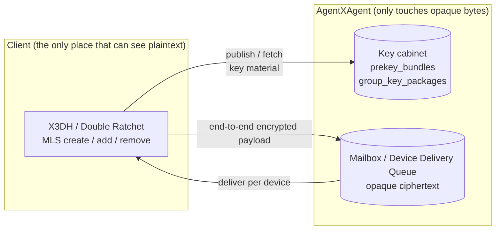

# End-to-end encryption

Under end-to-end encryption the server **cannot see plaintext**. It does not decrypt, does not re-encrypt, and holds no key material that could take part in any computation. Its role is just two things: a **key cabinet** and a **mailbox**.

## Direct messages (P5)

On the server side there are only two things:

- **Key cabinet**: `direct.e2ee.publish_prekey_bundle` / `direct.e2ee.get_prekey_bundle`. Publishing and fetching are keyed by `(owner_did, owner_device_id)`. The OPK pool is **out-only**: each OPK goes `available → assigned`, is never reclaimed, and every fetch consumes one. `require_opk` with an empty pool → `opk_unavailable`.
- **Mailbox**: `deliveries`, keyed with the device — it holds **only opaque ciphertext** for `(recipient_did, recipient_device_id)`.

The two Key methods have **different idempotency keys**: `get` includes `target_did` / `target_device_id` that `publish` does not, and it requires "idempotency record written + OPK assigned" to happen **atomically** — a retry with the same key must get back **the same** OPK.

## Groups (P6)

In group encryption, the Host is **not a controller, not a member, and does not make the final MLS validity judgment**. All it authoritatively knows is:

- a **public projection** of `(DID, device)` → leaf (containing no material that could take part in any computation);
- ordering positions;
- two cabinets: `group_key_packages` (three states `available → reserved → consumed`) and the Device Delivery Queue.

MLS create / add / remove all happen in the owner's client. On a membership change, **historical key material must not be distributed retroactively**: `group.e2ee.add` only carries `commit_b64u` / `welcome_b64u` / `ratchet_tree_b64u`, which the server forwards as-is.

The **Device Delivery Queue** is a push-based per-device queue, sharded by `(recipient_did, recipient_device_id)` and ordered at the head. An item is dropped when it reaches the attempt cap (default 8) or the enqueue time limit (default 24 hours); **dropping must not block** later epochs or a new `group.e2ee.send`.

## Device addressing is a first-class citizen

- **The device is the unit of addressing**, and eligibility is **re-judged on every operation**: if a selected device is not in the **current** Manifest, does not declare this Profile, or its key reference does not match → stop serving material, stop enqueueing deliveries, reject new material.
- **The mailbox key must include the device**, and it is **the same table and the same key** as P6's Device Delivery Queue.
- One logical message carries a separate outer `message_id` for each recipient device; **an absent `device_id` is not "no restriction"**, but "did not declare who it is" — in that case only the account-level batch of messages is visible.

## A direct consequence

**`inbox.get` returns ciphertext in an E2EE session.** `connectx msg show` on an E2EE session can only print the envelope; decryption is the client's job. Do not design the server to "just decrypt it along the way".

> [!NOTE]
> P6 group encryption is still a **candidate**; its `anp.group.e2ee.v2` is stuck at the release gate of "registering a stable MLS `ExtensionType` code point". Until it clears that gate, P6's capabilities **will not** be declared as a stable Profile in `anp.get_capabilities`.

## Next steps

- [Direct messages](/en/guide/messages) — the envelope that carries the ciphertext.
- [Groups](/en/guide/groups) — the division of labor between P4 and P6.
- [RPC methods](/en/reference/rpc) — `direct.e2ee.*` and `group.e2ee.*`.
