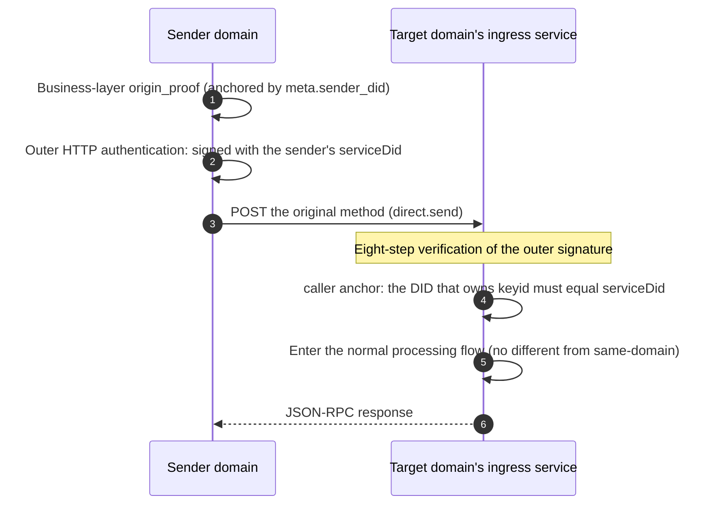

# Federation and cross-domain

**Federation has no relay protocol.** The sender domain **directly reuses the original business method**; no Relay wrapper method is added. The sender domain finds the target domain by `target.kind` and POSTs the **original** method to the other side's ingress service.

## Two identity layers, do not mix

| Layer | Who | How it is used |
|---|---|---|
| **Outer HTTP** | the sender domain's `serviceDid` | `Signature-Input` / `keyid` handed to the other side for verification |
| **Business layer** | `meta.sender_did` + `auth.origin_proof` | end-to-end evidence, **forwarded as-is, must not be rewritten** |

- **The original `origin_proof` is forwarded as-is**: an intermediate service re-signing it destroys the end-to-end evidence.
- Outer HTTP authentication **must** use the sender domain's `serviceDid` (a bare-domain DID is preferred), and **must not** use the business `sender_did`.

## caller anchor: one function serving two places

The receiver determines the **anchor** by method, then verifies whether the DID that owns `keyid` equals the anchor:

| Request type | Anchor |
|---|---|
| Ordinary request | `meta.sender_did` |
| Group notification (`group.incoming` / `group.state_changed` / `group.e2ee.notice`) | **`body.group_did`** |

These two rows must be written side by side in **the same function**. Splitting them into two separate checks is the most classic vulnerability in this kind of implementation — validate a group notification with `sender_did` and an attacker only needs to create a DID in their own domain to impersonate any group. The same `callerAnchor()` also serves the business layer's proof-ownership check; writing it once in each of the two places brings that vulnerability right back.

## Requests synchronous, notifications asynchronous

- **Requests** (`direct.send` / `group.*` / `attachment.*`) are **forwarded synchronously** in the request path: forward outside the transaction → the remote side accepts → persist inside the transaction → respond. A rejected request is **not** persisted.
- **Notifications** (`direct.incoming` / `group.*` pushes) go through an **asynchronous outbox**; see [Architecture and delivery](/en/guide/architecture).

A retry **keeps** the same `operation_id` / `message_id`, a semantically equivalent payload, and an unchanged device selector. Internal trace / attempt fields **must not** substitute for the idempotency key.

> [!NOTE]
> `direct.incoming` is **not** cross-domain transport — it is the last hop within the same domain, from "ingress service → recipient endpoint". What is forwarded across domains is always the original business method (such as `direct.send`).

## DID deactivation

- Before application processing it may return HTTP **409**; after entering application processing it returns `anp.did_superseded`.
- The same request **MUST NOT** return both layers.

## Failures and status codes

Outer authentication failure uses a **real HTTP status code** (such as `401`, with `WWW-Authenticate`), because this layer has no JSON-RPC envelope yet. Once you enter the business layer, errors go back to the rule of "always 200 + `error.data.anp_code`". A non-2xx is a **response**, not an exception.

## Next steps

- [Architecture and delivery](/en/guide/architecture) — the outbox and backoff.
- [Identity and addressing](/en/guide/identity) — where `serviceDid` comes from.
- [Deployment and configuration](/en/guide/deploy) — receiving cross-domain requires explicitly allowing the other domain.
