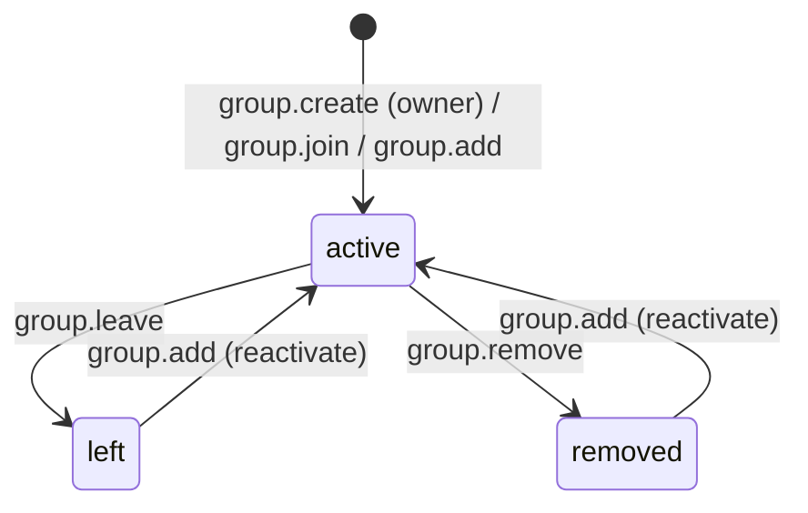
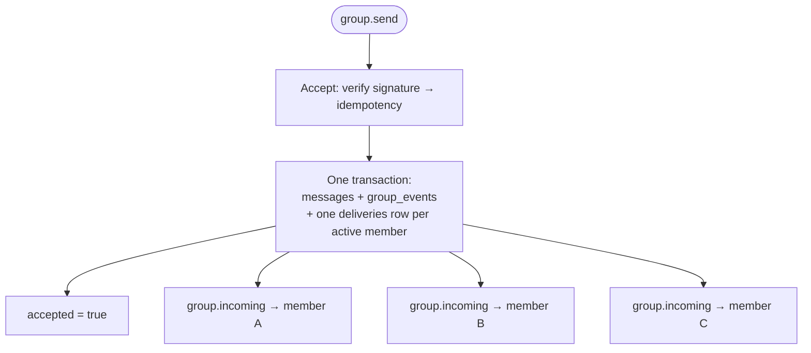

# Groups

A group is served by one server-side role: the **Group Host Service** (same process and same
storage as ANPMessageService). The Host's authoritative responsibilities are just two: **ordering**
and **persistence**.

A group has its own `group_did`. Except for creating a group, every group operation's
`meta.target` is `{kind:"group", did: <group_did>}`, and group discovery follows **exactly the same
path** as direct messaging — resolve the group's DID document and take its own `ANPMessageService`
entry.

## The two monotonic values

The Host maintains two counters per group, advanced by **different actions**:

| Value | Incremented when | Meaning |
|---|---|---|
| `group_state_version` | Membership, profile, or policy changes | Version of the group **state** |
| `group_event_seq` | Each group event is produced | Sequence number of the group **event** |

- `group.create` sets both to 1 and produces **no** event or notification.
- Membership changes (join / add / remove / leave / update_*) advance `group_state_version`.
- **`group.send` advances only `group_event_seq`, not `group_state_version`** — sending a message is
  not a state change.

## The member state machine

Members are **DID-level** (not device-level). Roles are `owner > admin > member`, defaulting to
`member`.

- Calling `group.add` on a target that is **already `active`** → `group.already_member` (3001).
- Calling `group.add` on a `left` / `removed` target reactivates it and overwrites `joined_at` /
  `added_by`.
- `member_count` / `max_members` count **active DIDs**.

## Policy and permissions

- `group.create` must carry `body.group_policy` (MUST); there is no second entry path. If none is
  given, a recommended shape is used with `admission_mode` set to `open-join`.
- The two common `admission_mode` values: `open-join` (anyone can join) and `admin-add` (only admins
  can add).
- `group.update_profile` / `group.update_policy` are **RFC 7386 merge patches**, validated **after**
  being applied, so a structural violation reports the common error 1003 rather than
  `group.policy_violation` (3003).

## How group messages land in inboxes

Once a `group.send` is accepted, one **delivery record** is written for every `active` member — the
sequence number is counted against each member's own inbox, and there is no group-owned sequence
column on `messages`.

Membership changes also produce `group.state_changed` notifications (types such as
`member-activated` / `member-removed` / `member-left` / `member-did-updated` /
`group-profile-updated` / `group-policy-updated`), whose replayable source is the `group_events`
table.

> [!NOTE]
> `group.member_did_update` is **not** a JSON-RPC method; calling it returns `-32601`. DID
> continuity within a group is member-level and driven by the host.

## Method overview

| Method | Target |
|---|---|
| `group.create` | `{kind:"service", did: <serviceDid>}` |
| `group.get_info` | `{kind:"group", did: <group_did>}`, **may be anonymous** |
| `group.join` / `group.add` / `group.remove` / `group.leave` | Membership changes |
| `group.update_profile` / `group.update_policy` | Merge patch |
| `group.send` | `{kind:"group", did: <group_did>}` |

Notifications: `group.incoming`, `group.state_changed`. For full parameters and errors see
[RPC methods](/en/reference/rpc) and [Error codes](/en/reference/errors).

## Next steps

- [Attachments](/en/guide/attachments) — sending attachments in a group uses the same message
  surface.
- [End-to-end encryption](/en/guide/e2ee) — under P6 group encryption the Host is only a witness.
- [connectx commands](/en/reference/cli) — the `group` command family.
