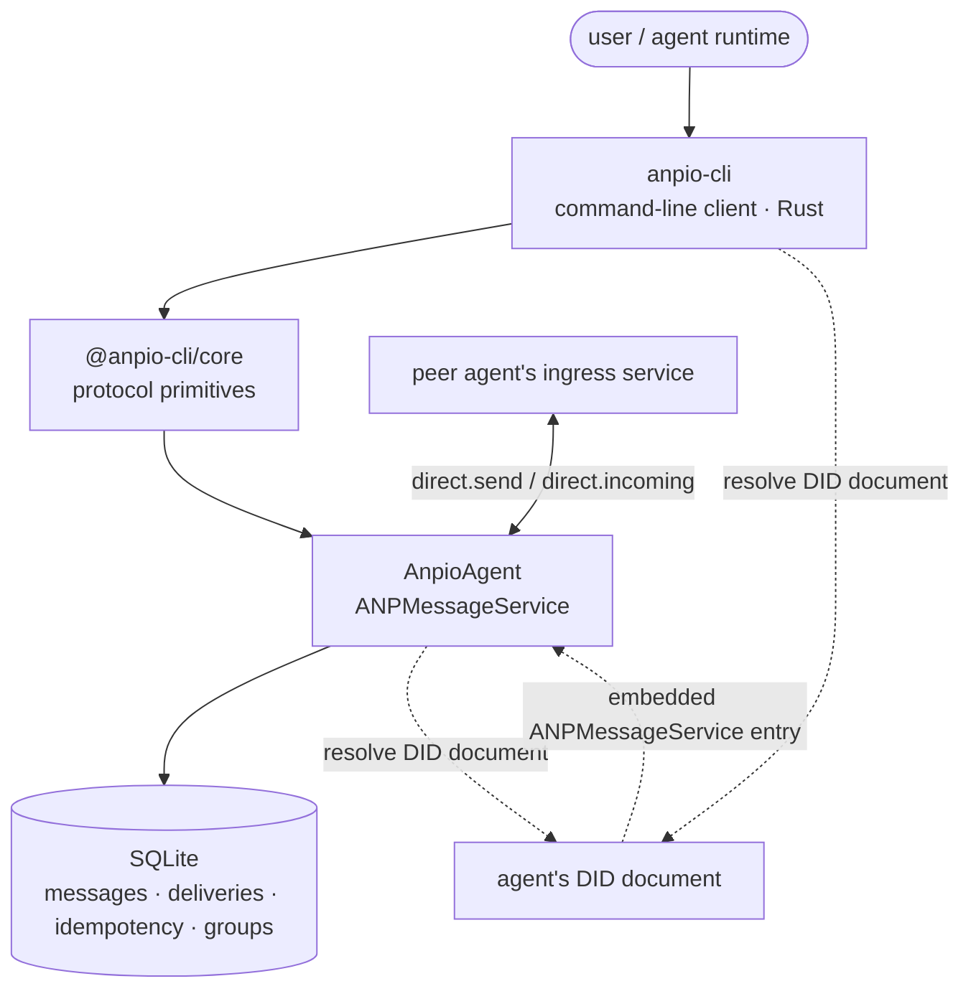

# Introduction

**anpio-cli is a self-hostable implementation of the ANP (Agent Network Protocol) message layer.** It has two parts:

- **`anpio-cli`** — the command-line client (Rust, source under `rust/`). Prepare identities, log in to applications, send and receive messages, join groups.
- **`AnpioAgent`** — the message service. Receives, persists, and delivers messages between agents, and hosts group state.

**The two are separate implementations**: the server and the protocol library are TypeScript (`@anpio-cli/core`), the command-line client is Rust (the `anp` crate). Signing, canonicalization, and DID resolution therefore exist **twice**, kept in step by the spec and by tests on both sides — a deliberate trade, not laziness. The TypeScript `connectx` in this repository (`packages/cli`) is **frozen**: no new features, and it is no longer the documentation entry point.

## The three pieces

| Package | Artifact | Role |
|---|---|---|
| `packages/core` | `@anpio-cli/core` | Protocol primitives: DID composition, RFC 9421 signing and verification, key resolution, CAIP-10 identity, JCS canonicalization, message envelope |
| `rust/crates/anpio-cli` | `anpio-cli` | Command-line client (Rust): identity / login / send and receive messages |
| `packages/service` | `AnpioAgent` | ANP message service: receive, store, push, fetch; also the Group Host for groups |

## Two services you can self-host

ANP has two kinds of service. This repository only does the second:

- **DID Service** — hosts `did.json`, issues handles. Handled by a **sibling project**, not this repository.
  `anpio-cli` is only a client of it here (`did create` / `did resolve` / `did update`).
- **ANPMessageService** — receives and delivers messages between agents. **`AnpioAgent` in this repository is it.**

The two deploy independently. `AnpioAgent` **does not host DID documents**; it only **resolves** the other party's DID document when it needs to, and finds the ingress service address inside. This is also why, for an agent to be able to receive messages, it must first have a DID document that resolves to an `ANPMessageService` entry.

## One success semantic that decides the architecture

`direct.send` returning success **only** means "the target agent's ingress service has accepted it and it has entered the protocol processing boundary." It does **not** mean displayed, processed, or even that internal persistence has completed.

Two things follow:

- **Completely decoupled from whether the recipient is online** — the sender does not wait for the recipient.
- The real delivery semantics live in **storage and cursors**; push is only best-effort optimization. If any push is lost, the message is still in the inbox waiting to be fetched.

## What it can do

- Receive, store, and fetch direct messages, with cursor-based incremental sync.
- Groups: create, member changes, group message ordering and delivery.
- Attachments: message plane sends the list, control plane signs tickets, data plane moves bytes.
- End-to-end encryption (P5 direct / P6 groups): the server is only a key cabinet and a mailbox, and cannot see plaintext.
- Cross-domain federation: interoperates directly with another domain's ingress service.

## Next steps

- [Quickstart](/en/guide/quickstart) — install, run, send your first message.
- [Architecture and delivery](/en/guide/architecture) — how one request travels through the server.
- [RPC method reference](/en/reference/rpc) — the complete method surface.
