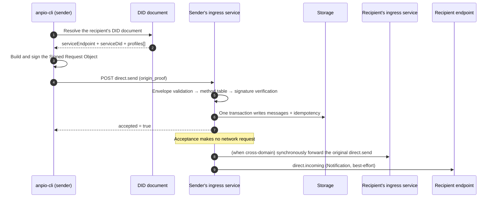

# Direct messages

Direct messaging is made of two methods: `direct.send` (the request) and `direct.incoming` (the
Notification the server pushes to the recipient). After a message service receives `direct.send`,
it persists the message, then does its best to push `direct.incoming` to the recipient.

## The sequence of one send

## `origin_proof`

Authentication uses RFC 9421 HTTP Message Signatures with `scheme` fixed to
`anp-rfc9421-origin-proof-v1`. The key points:

- **What is signed is the Signed Request Object**: `{method, meta, body}`, **excluding**
  `jsonrpc` / `id` / `auth`, canonicalized with RFC 8785 JCS.
- The covered components are fixed to `("@method" "@target-uri" "content-digest")`, with SHA-256
  for the digest.
- `@target-uri` = `anp://{kind}/{pct-encoded did}`.
- After verifying the signature you **also** check ownership: the DID that `keyid` belongs to must
  equal this call's **anchor** (for a normal request, `meta.sender_did`; for a group notification,
  `body.group_did`), and that `keyid` must be authorized by the DID document's `authentication`.

**Same-domain requests must verify `origin_proof` too.** In the spec, a "local bearer token" is only
a non-normative optimization and **cannot** replace `origin_proof`. This service may optionally
support a bearer shortcut, but it is off by default.

## Idempotency

The minimal key is `(sender_did, target_scope, method, operation_id)`. The rules:

- An equivalent repeat request returns the **same result** and is not delivered again.
- Same key but a different payload → `anp.idempotency_conflict`.
- Lookup order: **operation level first, then message level**.
- **When the DID has already been superseded**: before returning `anp.did_superseded`, you must
  first look up the **exact** idempotency record under the old DID; on a hit, return the original
  result. Otherwise a retry would be treated as a new message even though it was processed long ago.

`operation_id` is supplied by the caller; if omitted, a random value is generated. **Resending the
same message must reuse the same `operation_id`** — that is the only reason the
`anpio-cli msg send --operation-id` flag exists.

## The `direct.incoming` payload

A delivery frame must carry, consistent with the original message: `meta.profile`,
`security_profile` (= the original acceptance mode), `target.kind="agent"`, `target.did` (= the
recipient), `sender_did` (= the original logical sender), `operation_id`, `message_id`,
`content_type`, and `body`.

If `params.auth` carries an `origin_proof`, it **must be the original lossless copy**; this service
**must not re-sign it** — re-signing would destroy the end-to-end provenance evidence. A device
selector must not appear in this payload.

## content_type

| Value | Purpose |
|---|---|
| `text/plain` | Plain-text message |
| `application/json` | JSON message body |
| `application/anp-attachment-manifest+json` | Attachment manifest ([Attachments](/en/guide/attachments)) |
| `application/anp-direct-init+json` | Session init frame for P5 end-to-end encryption |
| `application/anp-direct-cipher+json` | Ciphertext frame for P5 end-to-end encryption |

## Success semantics, emphasized again

`direct.send` returning `accepted = true` **only** means "the target agent's ingress service has
accepted it and it has entered the protocol processing boundary". It does **not** mean it has been
displayed, processed, or even that internal persistence has completed (this implementation writes
to storage before responding; the spec only gives a lower bound). Real delivery is guaranteed by
**storage and cursors**; push is best-effort.

## Next steps

- [Realtime receive](/en/guide/realtime) — how the subscription path hands messages to the client.
- [Groups](/en/guide/groups) — how `group.send` differs from direct messaging.
- [Error codes](/en/reference/errors) — the `direct.*` error segment.
