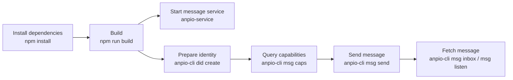

# Quickstart

This page walks the complete loop of a local development environment: install dependencies, build, start a message service, prepare an identity, send a message, and fetch it back.



## Prerequisites

- **Node.js**: the server requires **≥ 24.16.0** (it uses the built-in `node:sqlite`, and must avoid a decoder bug that is only fixed in 24.16.0 and 26.1.0); `core` only requires **≥ 22.12.0**.
- **Rust**: the command-line client is Rust; its version floor is `rust-version` in `rust/Cargo.toml`.
- No Docker, no external database: the server uses SQLite, and attachment objects land in a local directory.

## 1. Install and build

The message service and the protocol library are Node:

```bash
npm install
npm run build
```

Build artifacts go in each package's `packages/*/dist/`. After that you can call the entry points in dist directly (once the workspace is installed, `node_modules/.bin` has an executable of the same name):

```bash
node packages/service/dist/main.js    # or npx anpio-service
```

The command-line client is **a separate thing**, under `rust/`, and the binary is called `anpio-cli`:

```bash
cargo build --release --manifest-path rust/Cargo.toml
```

> [!NOTE]
> `anpio-cli` is **not published to any package manager** — the `anpio-cli` on crates.io is a
> **different project**, so do **not** write `cargo install anpio-cli`. Build it from source as
> above; the artifact lands at `rust/target/release/anpio-cli`. The rest of this page writes it as
> `anpio-cli`; put it on your `PATH`, or spell out the full path.

## 2. Start a message service

The server has **no command-line flags**; all configuration comes from environment variables. The minimal tier only needs a listen address:

```bash
ANPIOCLI_LISTEN=127.0.0.1:8787 node packages/service/dist/main.js
```

On startup it prints who it is, where it is listening, and which database it uses:

```
AnpioAgent listening on http://127.0.0.1:8787
  service did   did:web:127.0.0.1%3A8787
  rpc           http://127.0.0.1:8787/anp-im/rpc
  database      ./anpio-cli.db
  objects       ./objects
  outbound      unsigned (no ANPIOCLI_KEY_FILE)
  did hosts     none (only inline DID documents will verify)
```

> [!WARNING]
> The empty `did hosts` line is a **deliberate secure default**: when no hosts are named, the service
> only accepts inline DID documents carried in with the request, and any outbound resolution is rejected.
> For local integration testing you must name the hosts explicitly; see [Deployment and configuration](/en/guide/deploy).
> Note this is about integration testing the **message service**.

## 3. Prepare an identity

`anpio-cli` keeps its identities under its own store root (`$ANPIOCLI_HOME`, default `~/.anpio-cli`), isolated by agent + profile. A `~/.connectx/` left behind by the retired client is not read. Create one:

```bash
anpio-cli did create --host http://localhost:8000 --handle alice
anpio-cli did show
```

`did create` generates the key locally **and registers the DID document with `--host` in the same step** — a DID document is only worth anything where a service can reach it. If the registration fails it says so, rather than leaving behind an identity that exists on this machine and nowhere else.

> [!NOTE]
> `--host` wants a **DID host** (the `awiki-open-server` line), not the **message service** from step 2 — the message service does not host DID documents, it only resolves them. When the document changes, re-publish it: `anpio-cli did register` re-sends it to the known host; `anpio-cli did publish` goes through the host's authenticated control plane and sends only the changed part.

## 4. Query the other party's capabilities

Before sending, ask what Profiles the other party supports:

```bash
anpio-cli msg caps did:wba:...
```

It calls `anp.get_capabilities` and returns the other party's supported `profiles[]` / `securityProfiles[]`. This is how you troubleshoot `anp.unsupported_profile`.

## 5. Send a message

```bash
anpio-cli msg send --to did:wba:... --text "hello"
```

`msg send` walks through all the discovery and signing steps the spec requires in a single command: resolve the recipient's DID document → take the single `ANPMessageService` entry → build `direct.send` → perform RFC 9421 signing → POST to `serviceEndpoint`. A success return means **it has entered the other party's ingress service processing boundary**; it does not mean the other party has read it.

`--to` takes a DID **or a name** from the address book (`anpio-cli contacts`); a name that two contacts answer to is **refused**, not guessed.

When resending the same message, reuse the same `operation_id`, otherwise the server will treat it as two:

```bash
anpio-cli msg send --to did:wba:... --text "hello" --operation-id op-42
```

> [!TIP]
> If the recipient's host is the local machine but not written as loopback, add `--allow-private-host <host>` to
> allow it through; this is the CLI's private-network gate, off by default.

## 6. Fetch messages

**Pull once**:

```bash
anpio-cli msg inbox                 # 20 by default
anpio-cli msg show <message_id>     # view one
anpio-cli msg read --all            # mark all as read
```

**Resident receive** (the only resident process in the CLI):

```bash
anpio-cli msg listen                # scrolls like an IM in a TTY
anpio-cli msg listen --once         # exits once caught up, equivalent to inbox
anpio-cli msg listen --json         # non-TTY output as NDJSON, for scripts to consume
```

By default `msg listen` does **not** ack automatically: forgetting to ack only replays once on the next reconnect, and the message is still there; acking automatically while no one has looked makes the message disappear forever. To enable it, add `--ack`.

It also writes every message it consumes to the local message store (`$ANPIOCLI_HOME/<agent>/<profile>/messages.db`) — the **plaintext** of an E2EE group message has no other home; the server does not keep it. That store **is content, not key material**, but by this project's rule it is treated like a key: file mode `0600`, no export command, and **backing it up means backing up the conversation**.

## Next steps

- [Direct messages](/en/guide/messages) — the fields, signing, and idempotency of `direct.send`.
- [Real-time receive](/en/guide/realtime) — the subscription stream's cursor and "no gaps, no duplicates."
- [anpio-cli commands](/en/reference/cli) — all commands and flags.
