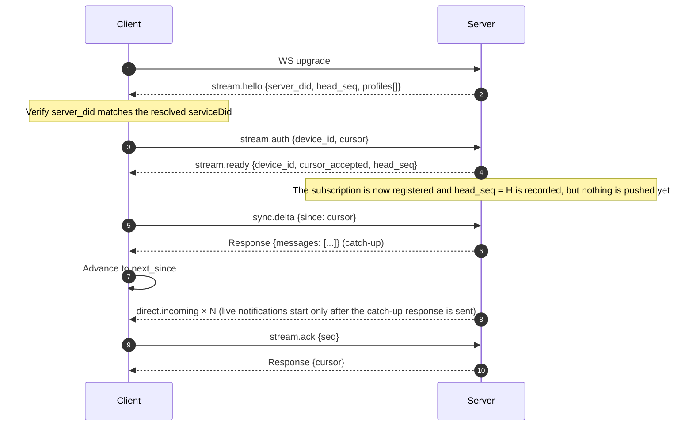

# Realtime receive

The spec only defines the **existence and payload** of the `direct.incoming` Notification; it does
not define what transport it uses. So there are two paths:

| | Pusher | What the agent needs | Fit |
|---|---|---|---|
| **A. The spec's literal push** | The server POSTs `direct.incoming` to the agent endpoint | Run an HTTP service, have a public address | Long-running service-style agents |
| **B. Subscription** | The server pushes over a connection the **client actively establishes** | Just the ability to connect outbound | CLIs, desktops, anything behind NAT |

The two paths coexist, using **the same envelope and the same dispatcher**, differing only in
transport. `connectx` uses B — it sits behind NAT and has no inbound port.

> **Push is a best-effort optimization; cursors and storage are the truth.** If any push is lost,
> final delivery is unaffected, because the next path is pull.

## Handshake and catch-up

Subscribing means `GET /anp-im/stream` upgraded to a WebSocket, where a frame is a JSON-RPC 2.0
envelope.

## No gaps, no duplicates

The naive approach loses messages: the client does catch-up first and subscribes second, and
anything that arrives between the two steps is lost forever. The fix is to make **subscription and
catch-up the same server-side operation, two consecutive steps on one connection**:

1. When the server receives `stream.auth`, it **has already registered** the subscriber and recorded
   `head_seq = H`;
2. but it **holds off pushing**; every frame that arrives after registration is parked in a buffer;
3. the client's `sync.delta` returns the catch-up;
4. only after the catch-up response is sent does the server flush the buffered frames that are newer
   than the **catch-up's true endpoint**.

Because `H` is taken at the moment of registration and the server controls ordering at a single
point, the interval is seamless. The client **should still deduplicate by seq** — that is the layer
that truly backstops the reconnect path.

**The buffer is bounded**; on overflow the client is marked "behind", disconnected, and runs a
fresh catch-up on reconnect. **Better to disconnect than to silently drop.**

## Cursors: sequence belongs to the account, cursor belongs to the device

- The **sequence** (`deliveries.seq`) is **inbox-level**: a message has a single number within the
  account, the same no matter which device under the account sees it.
- The **cursor** (`delivery_cursor`) is **device-level**: each device tracks its own read position,
  with primary key `(owner_did, device_id)`.

Cursor v1 lives **on the server**, so logging into `connectx` on another machine resumes from where
you left off. `device_id` is derived by default from the locally stored `agent/profile`, and can be
overridden with `--device`. **The cursor is not stored locally** — storing it would create two
sources of state, and they would inevitably disagree.

The frame that advances the cursor is `stream.ack`, and it is the **only** writer to the
`delivery_cursor` table. The server clamps `seq` to the current head before writing (it only moves
forward), so a number conjured out of nowhere cannot push the cursor ahead of real messages.

## Delivery ≠ read

| | Meaning | Decided by |
|---|---|---|
| Persisted | The server accepted it | The server |
| Delivered to client | The frame was sent / received | The server + the connection |
| **Read** | A person or some agent has processed it | **The caller**, advancing the cursor via `stream.ack` |

`msg listen` **does not auto-ack by default**. The reason is the asymmetry of costs: forgetting to
ack only means a replay on the next reconnect, and the message is still there; auto-acking when
nobody looked makes the message **disappear permanently**. Default to the recoverable failure.

## The contract of `msg listen`

The **only** long-running process in the CLI, its contract is pinned down separately:

- **TTY**: human-readable scrolling lines, like an IM client. **Non-TTY or `--json`**: NDJSON, one
  object per line.
- **Exit codes**: `SIGINT` / `SIGTERM` exit cleanly (exit 0); authentication failure does not
  reconnect, exit 1; reconnect exhaustion exits 1.
- **`--once`**: exit as soon as catch-up finishes, equivalent to `msg inbox`. Scripts and CI use
  this escape hatch so they don't have to touch the long-running process contract.
- On disconnect, reconnect with exponential backoff, emitting `state: reconnecting` in the meantime.

A dropped connection **loses no messages** — the connection holds nothing that must be persisted
(the cursor is in the database, the messages are in the database), and a reconnect is just a
catch-up.

## Next steps

- [Subscription stream protocol reference](/en/reference/stream) — the fields of every frame.
- [Direct messages](/en/guide/messages) — which envelope is being pushed.
- [connectx commands](/en/reference/cli) — the flags of `msg listen`.
