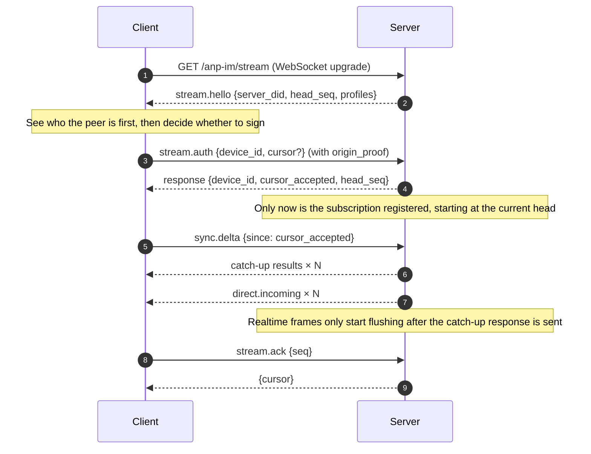

# Realtime subscription

Subscription goes through `GET /anp-im/stream` → a WebSocket upgrade. The upgrade on the wire is in
cleartext, and **the frames themselves are the application layer**: each frame is a JSON-RPC 2.0
envelope, fully isomorphic to the control plane, and each frame also carries its own
`origin_proof`.

This path fills in the half the spec deliberately left blank: the spec only says that the
`direct.incoming` notification exists, without saying how a recipient receives it. Subscription was
chosen over "the server POSTs to the agent endpoint" because `anpio-cli` sits behind a NAT and has no
inbound port.

## Handshake

Key ordering — reverse any of these and messages are lost:

1. **`stream.hello` comes first**, because the upgrade is in cleartext — the client has to know who
   the other side claims to be first. The `head_seq` it gives is a placeholder (the mailbox does not
   know yet), and the authoritative value comes with the handshake response.
2. **Registering the subscription** and **reading the head** are the same step: register first, then
   respond. The other way around, a message that falls between the two steps is neither held back
   nor re-sent.
3. **Realtime frames only start after catch-up is answered**. When the catch-up response is paged or
   rejected, the subscription keeps holding — this is the safe side.

## Methods

| Method | Direction | Payload |
|---|---|---|
| `stream.hello` | server → client (notification) | `{server_did, head_seq, profiles}` |
| `stream.auth` | client → server | `body: {device_id, cursor?}`, needs `origin_proof` |
| `stream.ack` | client → server | `body: {seq}`, needs `origin_proof` |
| `sync.delta` | client → server | `body: {device_id, since, limit?}`, inbox-surface extension |

`stream.auth` / `stream.ack` belong to the transport's own Profile `x_anpiocli.stream.v1`;
`sync.delta` belongs to the inbox surface `x_anpiocli.inbox.v1`. **Neither Profile is in
`anp.get_capabilities`**: that table is spec conformance, and the `profiles` in `stream.hello` are
what "this endpoint can do".

Constraints:

- `stream.auth` may be sent **only once** per connection; a second one is `invalid_request`.
- `stream.ack` must come after `stream.auth`, and **must be signed by the identity this connection
  has already authenticated**.
- A failed handshake authentication → send one error frame, then **close the connection** (`1000`),
  rather than leaving the client to guess why it dropped.

## Cursor

The cursor is a **per-`(owner_did, device_id)`** monotonic sequence number:

- **`stream.ack` is the only writer to the `delivery_cursor` table.** `sync.delta` does not write
  (catch-up is catch-up), and the handshake does not write.
- The `seq` of `stream.ack` is **clamped by the head**: the cursor never moves backward, and an ack
  that runs ahead of the queue would skip the cursor past real messages, silently under-reading on
  the next reconnect — so clamp it here.
- `--since` covers **this one** catch-up only; it is not written back. Writing a debug switch back
  to storage turns debugging into lost history.

**Delivery ≠ read.** The cursor means "this device received it", not "someone has seen it". The spec
defines no read receipt for the sender, and neither is `stream.ack` one.

## Catch-up: no gaps, no duplicates

- At the moment of registration the server gives `head_seq = H`, and catch-up covers `(C, H]`.
- The **real endpoint** of catch-up is where `sync.delta` actually answers to; it may be further than
  H — realtime frames only start after that endpoint.
- Each catch-up item **carries a `seq`**; the client deduplicates by high-water mark and drops the
  duplicates.
- Losing any single push does not affect final delivery: **push is a best-effort optimization;
  cursors and storage are the truth.**

## Close codes

| Code | Meaning |
|---|---|
| `1000` | Normal closure (including the close after failed handshake authentication) |
| `1001` | Server going away |
| `1002` | Protocol error |
| `1003` | JSON text frames only |
| `1007` | Invalid payload |
| `1009` | Message too big |
| `1011` | Server internal error, connection state unknown, disconnect |
| `1013` | Try again later |

Client behavior on a dropped connection: **reconnect with backoff and carry the cursor**; on a
**rejection** do not retry, because the same key will be rejected again.

## Next steps

- [anpio-cli commands](/en/reference/cli) — the four options of `msg listen`.
- [RPC methods](/en/reference/rpc) — the four notifications that are pushed.
- [Error codes](/en/reference/errors) — what an error in a frame looks like.
