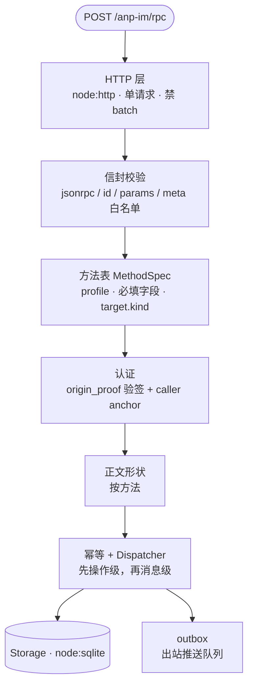
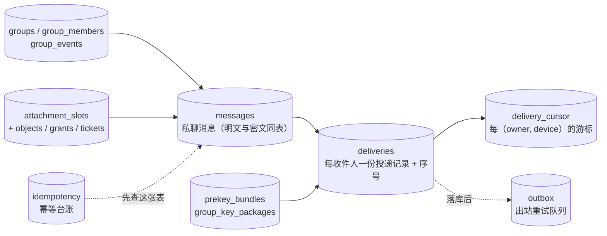
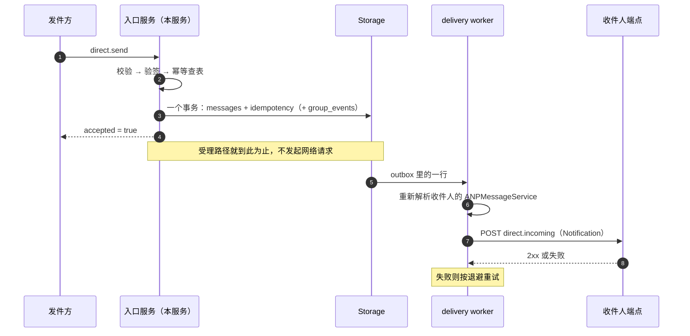

# 架构与投递

AnpioAgent 同时扮演两个角色，同一进程、同一份存储：

- **ANPMessageService** —— 接收、持久化、投递 agent 之间的消息。
- **Group Host Service** —— 群状态的排序与持久化。

## 受理路径

每条 `POST /anp-im/rpc` 请求都沿同一条路下降。**层的顺序本身就是设计**，不是实现细节。

两条顺序上的讲究：

- **方法表在认证之前**：方法表能判的（Profile / `security_profile` / 必填字段 / `target.kind`）
  不需要密钥，先判掉就少一次可以被填爆的出站 DID 解析。
- **认证在正文之前**：正文校验要读 `content_type`，而那是**调用方自己带来**的字段。
  没验签就拿它做判断，等于让未认证的一方指挥服务。

方法表是**数据**（`MethodSpec`）而不是 `switch`；一个 `targetMode` 字段同时给出
`target.kind` 该是什么、`target` 可否省略、以及目标绑定错误从哪来。

## 存储

持久层是 **SQLite**（`node:sqlite`，WAL 模式），接口化成 `Storage`，SQLite 是 v1 唯一实现。
表按用途分成几组：

- **幂等记录与消息在同一个事务里写**。规范没要求，但不这么做就没有任何东西能保证
  "重试得到同一结果"——一半落库的中间态会让这句话落空。
- **存的是操作的结果，不是 JSON-RPC 信封**：重试是另一次请求、带自己的 `id`，回放一个
  存下来的信封会把首个请求的 `id` 答给重试。
- 交付序号是**收件箱级**的（`deliveries.seq` 按 `owner_did` 递增），游标是**设备级**的
  （`delivery_cursor` 的主键是 `(owner_did, device_id)`）。两者不是一回事。

## 落库 → 应答 → 推送

一次 `direct.send` 的处理顺序：

**受理路径不发起任何网络请求**，只在 `outbox` 落一行；推送与重试全在 delivery worker。
分家的理由只有一条：受理的整个操作（消息 + 投递 + 幂等记录）必须在**一个事务**里，
而事务里不能有网络往返——一次慢连接会让所有并发受理在锁上等。

## 出站推送与退避

- **推送目标每次重新解析**：不复用受理那一刻的答案。域名可以在两次重试之间换入口服务；
  钉住第一次的地址就会把重试打到一个可能已经不属于任何人的地方。所以 `outbox` 存的是
  收件人的 **DID**，不是解析出来的 endpoint。
- **本地投递不走 HTTP**：解析出来的端点若就是本服务的 `/anp-im/rpc`，直接丢掉那一行——
  收件人就住在这里，`deliveries` 那一行已经是持久的，订阅路会把它交出去。
- **退避**：5 秒起、每次翻倍、单次上限 5 分钟、最多 8 次，之后丢弃并记录次数与最后的错误。
  等待取 `[0.5, 1] × 退避值` 的抖动，好在同一批一起失败的条目之间错开。
- **重发不改变语义**：重试用同一份载荷，也就是同一个 `operation_id` / `message_id` / `body`，
  收件人按消息级重复识别会把它认出来。到顶丢弃是**有意的放弃**，不是成功。

## 运行环境

- TypeScript，服务端 **Node ≥ 24.16.0**。
- HTTP 层用 `node:http` 自己写路由：服务一共只有**五条**路由，引框架的收益是负的。
- **协议错误不换 HTTP 状态码**：`anp.*` 与 JSON-RPC 标准错误一律走 `200`，客户端按
  `error.data.anp_code` 分支。只有"连 JSON-RPC 对象都还不是"的传输层失败才用非 2xx。
  附件数据面是这条规则的例外。见 [HTTP 端点与自述](/reference/endpoints)。

## 下一步

- [身份与定址](/guide/identity) —— 服务怎么被找到。
- [私聊消息](/guide/messages) —— `direct.send` 的字段与签名。
- [部署与配置](/guide/deploy) —— 环境变量与安全默认。
