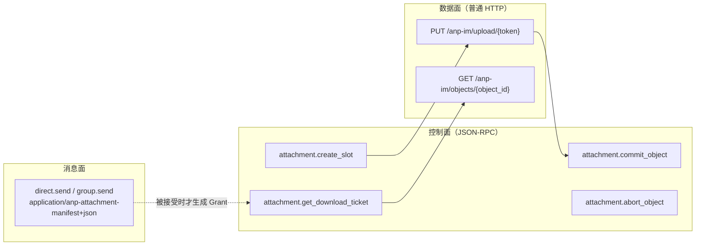
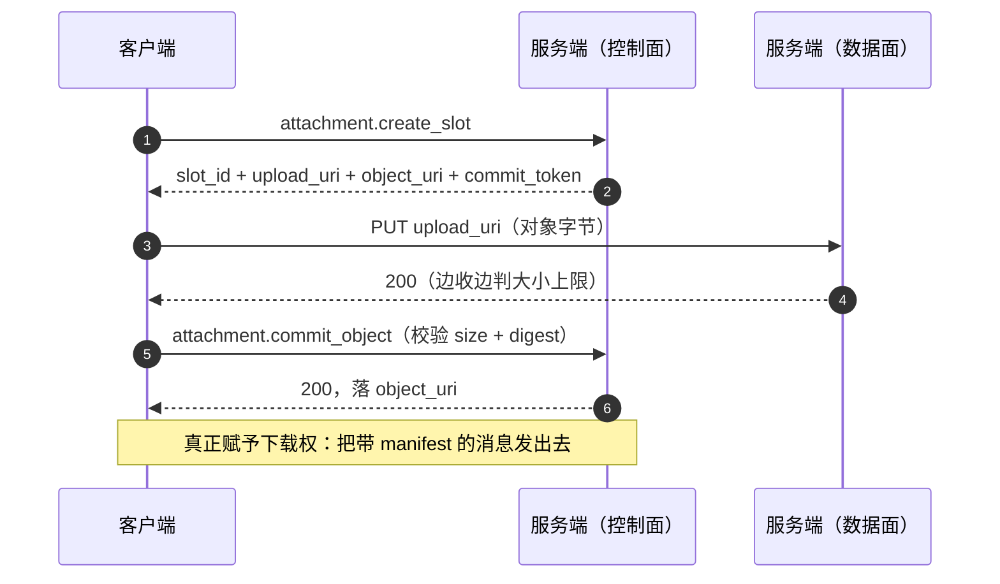

# 附件

附件被拆成**三个平面**，它们互不混淆，这是这一节的全部要点：

| 平面 | 走什么 | 做什么 |
|---|---|---|
| **消息面** | `direct.send` / `group.send` | 送**清单**（manifest）：附件 id、大小、摘要、加密模式 |
| **控制面** | `attachment.*` 四个方法 | 开槽、提交、放弃、签下载票据 |
| **数据面** | `PUT` / `GET` 两条 HTTP 路由 | 搬**字节** |



## 上传



四个控制方法都是 **service-scoped**（`target.did = serviceDid`），profile 为
`anp.attachment.v1`。

## 授权链：Grant 什么时候出现

**`create_slot` 与 `commit_object` 都不授予任何下载权。** 下载权（Grant）只在**承载清单的
那条消息被接受时**才生成——也就是 `direct.send` 或 `group.send` / `group.e2ee.send` 受理的
同一个事务里。这保证了"能下载"总是跟着"那条消息确实被收下了"。

## 下载

`attachment.get_download_ticket` 会跑七条检查（含**Access Grant 存在性**），通过后签发一张
**短时票据**。然后：

```
GET object_uri
Authorization: Bearer {download_ticket}
```

约束：

- `object_uri` **MUST** 是 `https://` URL，是 **locator 不是永久直链**。
- 票据 **MUST NOT** 放在 URL 参数里；默认有效期 **≤ 5 分钟**，可设为一次性。
- 调用方 **MUST NOT** 只凭 `object_uri` 的域名猜控制面服务——必须按原始消息的发送者 DID 解析。
- 群成员的资格在**签票据那一刻**判定，不是在消息发送时。
- 服务端只存**不透明字节 + 摘要**，**不含** `object_key` / `nonce`——对象密钥只随 P5/P6
  的内层 manifest 下发。

## 存储

对象字节按摘要寻址，落在 `<ANPIOCLI_OBJECT_DIR>/objects/<sha-256 base64url>`；控制面与数据面
的状态（槽位、对象、授权、票据）在 SQLite 里。**没有 GC，也没有追溯撤销**——对象与 Grant
从不删除，过期在**使用时**判定。

数据面是唯一用**真实 HTTP 状态码**的地方（`401` / `403` / `404` / `410` / `413` 等），
因为它没有 JSON-RPC 信封、也没有 `id` 可答。见 [HTTP 端点](/reference/endpoints)。

## 下一步

- [HTTP 端点与自述](/reference/endpoints) —— 两条数据面路由的状态码。
- [错误码](/reference/errors) —— `attachment.*` 的 6000 段。
- [RPC 方法](/reference/rpc) —— 四个控制方法的参数。
