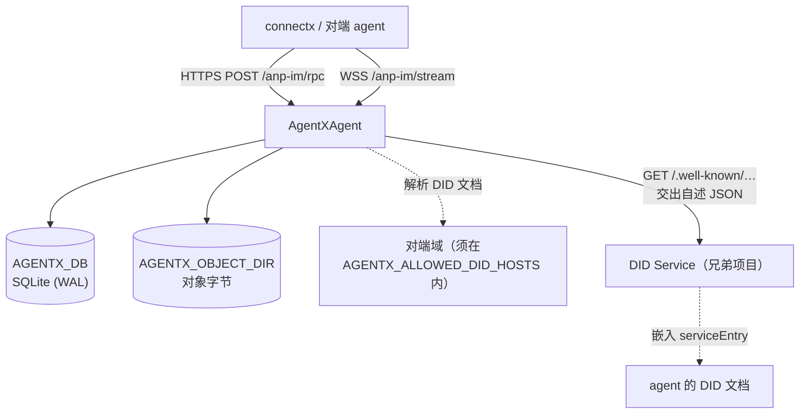

# 部署与配置

AgentXAgent 是一个**有状态的长驻进程**：它持有 SQLite 数据库、附件对象目录、WebSocket
订阅连接与投递 worker。它需要 Node ≥ 24.16.0，不需要 Docker，也不需要外部数据库。

> [!WARNING]
> 因为是有状态长驻进程，它**不适合**部署成 serverless 函数（Vercel Functions、Lambda 之类）——
> 没有持久文件系统、没有长连接。请把消息服务放在能跑常驻 Node 进程、并挂持久卷的主机上。
> 本仓库里的 `vercel/` 目录部署的是**文档站**，不是消息服务。

## 拓扑

## 环境变量

| 变量 | 默认 | 说明 |
|---|---|---|
| `AGENTX_LISTEN` | `127.0.0.1:8787` | 监听地址 `host:port`（IPv6 用方括号）。 |
| `AGENTX_PUBLIC_URL` | 由 `LISTEN` 推出 | 对外基址，用于 `serviceEndpoint` 与 `object_uri`。非 loopback 监听时**必填**。 |
| `AGENTX_SERVICE_DID` | 由 `PUBLIC_URL` 推出 `did:web` | 自己的服务 DID，必须是不带 fragment / query 的 DID 字符串。 |
| `AGENTX_KEY_FILE` | 未设 | 跨域出站签名钥（hex 或 PEM）。不设则出站请求不带外层身份。 |
| `AGENTX_KEY_ID` | 配了 `KEY_FILE` 就必填 | 该钥的 keyid，完整 DID URL 且必须挂在 `SERVICE_DID` 下。 |
| `AGENTX_DB` | `./agentx.db` | SQLite 路径，或 `:memory:`。 |
| `AGENTX_OBJECT_DIR` | 数据库文件旁的 `objects/` | 附件对象目录。 |
| `AGENTX_MAX_BODY` | `1048576`（1 MiB） | 请求体上限。附件走数据面，不经这里。 |
| `AGENTX_MAX_OBJECT_BYTES` | `67108864`（64 MiB） | 单个附件对象上限，数据面 PUT 时边收边判。 |
| `AGENTX_ALLOWED_DID_HOSTS` | **空** | 允许出站解析 DID 文档的**精确主机名**，逗号 / 空白分隔。 |
| `AGENTX_DID_DEV_HOSTS` | **空** | 联调放宽：这些域可解析私有地址、可用 http，并**同时进白名单**。 |
| `AGENTX_PREKEY_BURST` | `60` | 两条 Key 方法每个调用方的突发额度。 |
| `AGENTX_PREKEY_PER_MINUTE` | `60` | 同上，每分钟补充的令牌数。 |

## 安全默认：fail-closed

**没有配置项能关掉 `origin_proof` 校验。** 要联调就配宽松的 **DID 解析策略**，不要开后门——
那扇门会在某次部署里被忘掉。

- `AGENTX_ALLOWED_DID_HOSTS` 默认**为空**：只认随请求带进来的内联文档，任何出站解析都被拒。
- `AGENTX_DID_DEV_HOSTS` 是给本地联调用的，它同时把域名加进白名单、并允许私有地址与明文 http。
- 两者都要求**逐个点名**，所以没有哪个取值能让解析变成无界的。

代价：**接收跨域请求要解析对端的 DID 文档**，所以跨域接收在默认配置下跑不起来，必须把对端域
加进 `AGENTX_ALLOWED_DID_HOSTS`。关掉开关比放松白名单危险得多，所以这条不改。

## 出站签名钥

跨域调用时，外层 HTTP 认证要用发送方域的 `serviceDid` 签名。这需要一份密钥与它的 `keyid`：

- `AGENTX_KEY_FILE` 给出钥（hex 或 PEM）；
- `AGENTX_KEY_ID` 给出完整的 DID URL，且**必须挂在 `AGENTX_SERVICE_DID` 下**——
  否则每一份签出去的请求都会被对端按 `forbidden_did` 拒掉，而那个错误看起来像对端的问题。

不配钥时出站调用仍然会发，但不带外层身份，对端会把它当成同域调用：丢的是**域级归属**，
不是受理本身。

## 启动与关停

启动后 stdout 打印自己是谁、在哪监听、用的哪个库、出站是否签名、允许解析哪些域。启动失败时：

- 配置错误（`ConnectxError`）→ stderr 打印 `<code>: <message>`，**exit 2**；
- 其他错误 → 打印堆栈，**exit 1**。

收到 `SIGINT` / `SIGTERM` 时打印一行 `shutting down`，停止 worker、关闭所有订阅连接、
关闭服务与存储，**exit 0**。

## DID 文档自述

服务提供 `GET /.well-known/anp-message-service.json`，返回那段供 DID Service 嵌入的条目。
它的 `profiles[]` / `securityProfiles[]` 与运行时 `anp.get_capabilities` 的答复**同源**，
所以不会出现"文档说的和运行的不一样"。扩展能力不在那个条目里声明，另走一个 `x_agentx` 块。

见 [HTTP 端点与自述](/reference/endpoints)。

## 下一步

- [HTTP 端点与自述](/reference/endpoints) —— 路由、状态码与两段 JSON。
- [联邦与跨域](/guide/federation) —— 为什么要解析对端域。
- [架构与投递](/guide/architecture) —— 存储与 worker。
