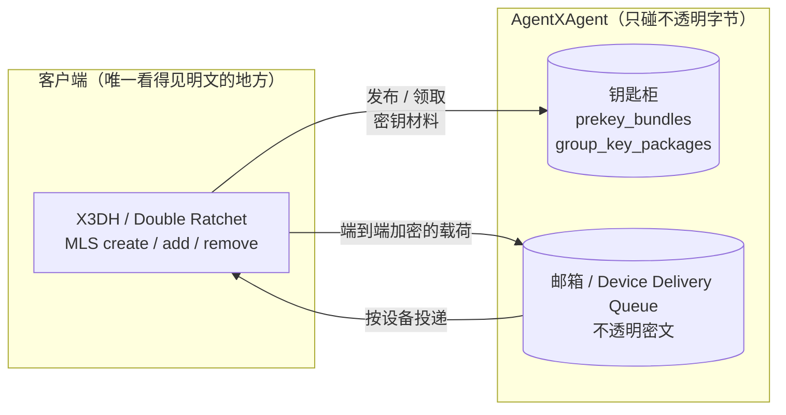

# 端到端加密

端到端加密下，服务端**看不见明文**。它不做解密、不做重加密，也不持有任何能参与运算的密钥
材料。它的角色只有两个：**钥匙柜**与**邮箱**。

## 私聊（P5）

服务端这一侧只有两件事：

- **钥匙柜**：`direct.e2ee.publish_prekey_bundle` / `direct.e2ee.get_prekey_bundle`。
  按 `(owner_did, owner_device_id)` 发布与领取。OPK 池**只出不进**：每个 OPK 状态
  `available → assigned`，永不回收，每次领取消耗一个。`require_opk` 而池空 → `opk_unavailable`。
- **邮箱**：`deliveries`，键含设备——**只放不透明密文**给 `(recipient_did, recipient_device_id)`。

两条 Key 方法的**幂等键不同**：`get` 比 `publish` 多出 `target_did` / `target_device_id`，
且要求"幂等记录写入 + OPK 分配"**原子**完成——同一键重试必须拿回**同一个** OPK。

## 群组（P6）

群组加密里，Host **不是控制者、不是成员，也不做最终 MLS 有效性判断**。它权威地知道的只有：

- 一份 `(DID, device)` → leaf 的**公开投影**（不含任何能参与运算的材料）；
- 排序位置；
- 两台柜子：`group_key_packages`（三态 `available → reserved → consumed`）与
  Device Delivery Queue。

MLS 的 create / add / remove 全在 owner 客户端。成员变更时，**历史密钥材料不得回溯分发**：
`group.e2ee.add` 只给 `commit_b64u` / `welcome_b64u` / `ratchet_tree_b64u`，服务端原样转发。

**Device Delivery Queue** 是 push-based 的设备队列，按 `(recipient_did, recipient_device_id)`
分片、队头有序。到达次数上限（默认 8 次）或入队时限（默认 24 小时）时丢弃，**丢弃不得阻塞**
后续 epoch 或新的 `group.e2ee.send`。

## 设备寻址是一等公民

- **设备是寻址单位**，且资格**每次操作都要重判**：所选设备不在**当前** Manifest 里、
  未宣告本 Profile、或密钥引用对不上 → 停止供材料、停止入队投递、拒绝新材料。
- **Mailbox 的键必须含设备**，与 P6 的 Device Delivery Queue 是**同一张表、同一个键**。
- 一条逻辑消息对每台接收设备各带一个外层 `message_id`；**缺席 `device_id` 不是"没有限制"**，
  而是"没声明自己是谁"——那样只有账号级的那批消息可见。

## 一个直接后果

**`inbox.get` 在 E2EE 会话里返回的是密文。** `connectx msg show` 在 E2EE 会话上只能打印
envelope，解密是客户端的事。设计上不要试图在服务端"顺手解一下"。

> [!NOTE]
> P6 群组加密目前仍是**候选**，它的 `anp.group.e2ee.v2` 卡在"注册一个稳定的 MLS
> `ExtensionType` code point"这道发布门槛上。在跨过门槛之前，P6 的能力**不会**在
> `anp.get_capabilities` 里声明为稳定 Profile。

## 下一步

- [私聊消息](/guide/messages) —— 承载密文的信封。
- [群组](/guide/groups) —— P4 与 P6 的分工。
- [RPC 方法](/reference/rpc) —— `direct.e2ee.*` 与 `group.e2ee.*`。
