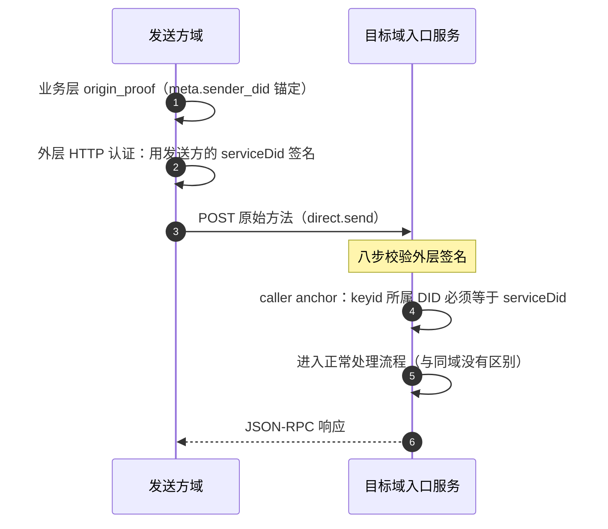

# 联邦与跨域

**联邦没有中继协议。** 发送方域**直接复用原业务方法**，不新增 Relay 包装方法。发送方域按
`target.kind` 找到目标域，把**原始**方法 POST 到对方的入口服务。

## 两层身份，不能混

| 层 | 是谁 | 怎么用 |
|---|---|---|
| **外层 HTTP** | 发送方域的 `serviceDid` | `Signature-Input` / `keyid` 交给对方校验 |
| **业务层** | `meta.sender_did` + `auth.origin_proof` | 端到端证据，**原样转发，不得重写** |

- **原始 `origin_proof` 原样转发**：中间服务重签会毁掉端到端证据。
- 外层 HTTP 认证**必须**用发送方域的 `serviceDid`（裸域名 DID 优先），**不得**用业务的
  `sender_did`。

## caller anchor：一个函数服务两处

接收方按方法确定**锚点**，再校验 `keyid` 所属 DID 是否等于锚点：

| 请求类型 | 锚点 |
|---|---|
| 普通请求 | `meta.sender_did` |
| 群通知（`group.incoming` / `group.state_changed` / `group.e2ee.notice`） | **`body.group_did`** |

这两行必须挨着写在**同一个函数**里。分成两处判断，就是这类实现最经典的漏洞——用
`sender_did` 去校验一条群通知，攻击者只要在自己域里建个 DID 就能冒充任何群。同一个
`callerAnchor()` 也服务业务层的 proof 归属校验，两处各写一遍就回到了那个漏洞。

## 请求同步，通知异步

- **请求**（`direct.send` / `group.*` / `attachment.*`）在请求路径里**同步转发**：
  事务外转发 → 远端接受 → 事务内落库 → 应答。被拒的请求**不**落库。
- **通知**（`direct.incoming` / `group.*` 推送）走**异步 outbox**，见[架构与投递](/guide/architecture)。

重试**保持** `operation_id` / `message_id`，负载语义等价，设备 selector 不变。内部
trace / attempt 字段**不得**替代幂等键。

> [!NOTE]
> `direct.incoming` **不是**跨域传输——它是同域内"入口服务 → 收件人端点"的最后一跳。
> 跨域转发的永远是原始的业务方法（如 `direct.send`）。

## DID 停用

- 应用处理前可返 HTTP **409**；进入应用处理后返 `anp.did_superseded`。
- 同一请求 **MUST NOT** 两层都返。

## 失败与状态码

外层认证失败走**真实 HTTP 状态码**（如 `401`，带 `WWW-Authenticate`），因为这一层还没有
JSON-RPC 信封。一旦进入业务层，错误就回到"一律 200 + `error.data.anp_code`"的规则。
非 2xx 是一个**响应**，不是一个异常。

## 下一步

- [架构与投递](/guide/architecture) —— outbox 与退避。
- [身份与定址](/guide/identity) —— `serviceDid` 从哪来。
- [部署与配置](/guide/deploy) —— 跨域接收要显式放行对方域。
