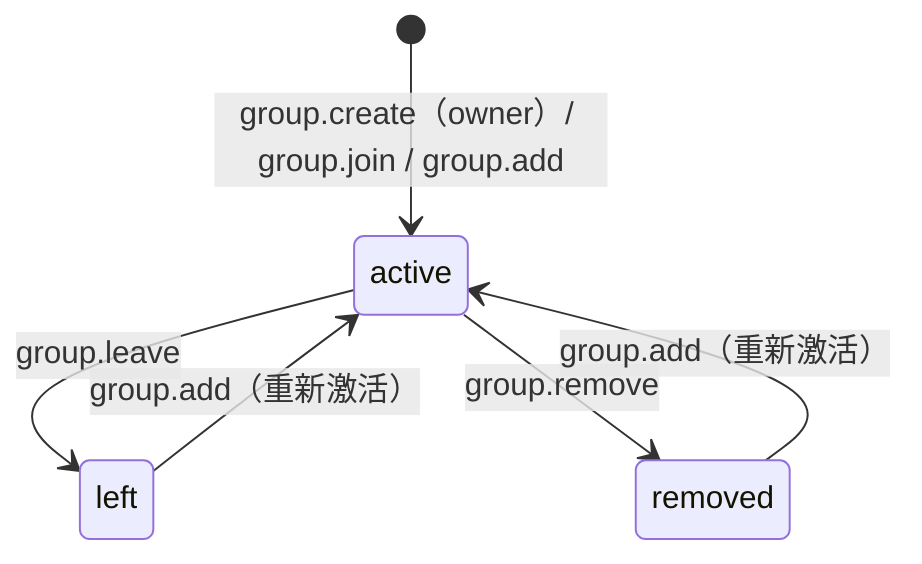
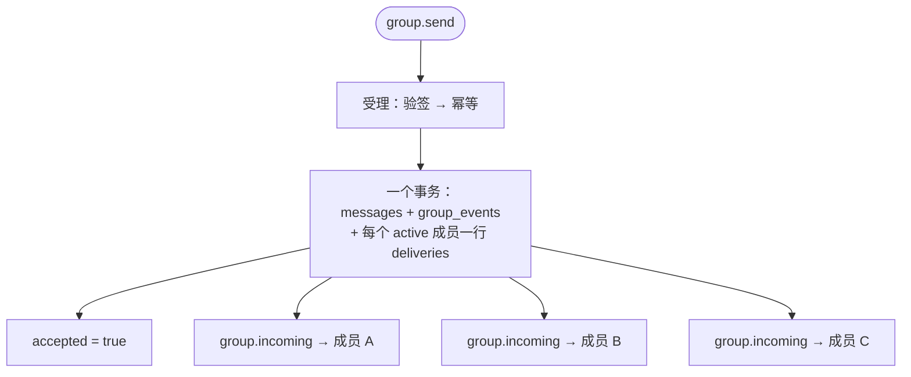

# 群组

群组由服务端的一个角色承担：**Group Host Service**（与 ANPMessageService 同进程、同存储）。
Host 的权威职责只有两件：**排序**与**持久化**。

群有自己的 `group_did`。除了建群，所有群操作的 `meta.target` 都是
`{kind:"group", did: <group_did>}`，而群组发现的路径与私聊**完全一样**——解析群的 DID 文档，
取它自己的 `ANPMessageService` 条目。

## 两个单调量

Host 在每个群上维护两个计数器，它们由**不同的动作**推进：

| 量 | 何时 +1 | 含义 |
|---|---|---|
| `group_state_version` | 成员、资料、策略发生变更 | 群**状态**的版本 |
| `group_event_seq` | 每产生一个群事件 | 群**事件**的序号 |

- `group.create` 把两者都设为 1，且**不产生**事件与通知。
- 成员变更（join / add / remove / leave / update_*）推进 `group_state_version`。
- **`group.send` 只推进 `group_event_seq`，不推进 `group_state_version`**——发消息不是改状态。

## 成员状态机

成员是 **DID 级**的（不是设备级）。角色 `owner > admin > member`，默认 `member`。

- 对一个**已经在 `active`** 的目标再 `group.add` → `group.already_member`（3001）。
- 对一个 `left` / `removed` 的目标 `group.add` 会重新激活，并覆盖 `joined_at` / `added_by`。
- `member_count` / `max_members` 统计的是 `active` 的 **DID** 数。

## 策略与权限

- `group.create` 必须带 `body.group_policy`（MUST），没有第二条进入路径。不给就用推荐形状，
  `admission_mode` 取 `open-join`。
- `admission_mode` 常见两档：`open-join`（任何人可 join）与 `admin-add`（只有管理员能 add）。
- `group.update_profile` / `group.update_policy` 是 **RFC 7386 merge patch**，在**应用之后**
  才校验，所以结构性违规报公共错误 1003，而不是 `group.policy_violation`（3003）。

## 群消息怎么落进收件箱

一条 `group.send` 被接受后，会为每个 `active` 成员各写一份**投递记录**——序号是按各成员
自己的收件箱算的，`messages` 上并没有一个属于群的序号列。

成员变更还会产生 `group.state_changed` 通知（类型如 `member-activated` / `member-removed` /
`member-left` / `member-did-updated` / `group-profile-updated` / `group-policy-updated`），
它的可重放来源是 `group_events` 表。

> [!NOTE]
> `group.member_did_update` **不是** JSON-RPC 方法，被调用时返回 `-32601`。DID 连续性在群里
> 是成员级、由宿主机驱动的。

## 方法一览

| 方法 | 目标 |
|---|---|
| `group.create` | `{kind:"service", did: <serviceDid>}` |
| `group.get_info` | `{kind:"group", did: <group_did>}`，**可匿名** |
| `group.join` / `group.add` / `group.remove` / `group.leave` | 成员变更 |
| `group.update_profile` / `group.update_policy` | merge patch |
| `group.send` | `{kind:"group", did: <group_did>}` |

通知：`group.incoming`、`group.state_changed`。完整参数与错误见
[RPC 方法](/reference/rpc) 与 [错误码](/reference/errors)。

## 下一步

- [附件](/guide/attachments) —— 群里发附件走同一套消息面。
- [端到端加密](/guide/e2ee) —— P6 群组加密下 Host 只当见证者。
- [connectx 命令](/reference/cli) —— `group` 族命令。
