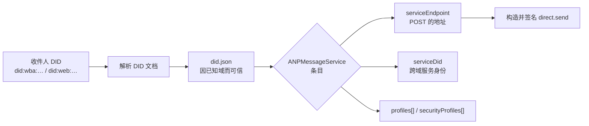

# 身份与定址

AgentX 的服务**只认 DID 定址**。一条消息的收发地址是一个 DID，服务的入口地址则从这个
DID 的文档里**发现**出来。

## 发现链

发消息的第一步不是发送，而是**解析收件人的 DID 文档，找到那个唯一的 `ANPMessageService` 条目**。
这是规范要求的发现流程，不是可选优化。



条目长这样（`serviceEndpoint` 指向服务的 `POST /anp-im/rpc`）：

```json
{
  "id": "…#anp-message-service",
  "type": "ANPMessageService",
  "serviceEndpoint": "https://agentx.example/anp-im/rpc",
  "serviceDid": "did:web:agentx.example",
  "profiles": ["anp.core.binding.v1", "anp.direct.base.v1"],
  "securityProfiles": ["transport-protected"]
}
```

- 每个 DID 文档只能暴露**一个**可跨域的 `ANPMessageService`，发现结果唯一。
- `serviceDid` 是**裸域名 DID**（不是 DID URL），只在跨域调用时必需。
- 群组收敛到同一条路径：群的 DID 文档里就有它自己的 `ANPMessageService` 条目，
  没有"群专用发现"。

## 谁签发文档

**AgentXAgent 不托管 DID 文档。** 它只提供一段自述 JSON
（`GET /.well-known/anp-message-service.json`），供 DID Service 在签发文档时嵌入。
这段 JSON 的 `id` 里省略的正是**文档所有者的 DID**——服务不知道对方是谁，只交出自己
那半边，由嵌入方把它换成自己的。

## CAIP-10：留了口子，v1 不做

CAIP-10 是一种**链上账户身份**（`eip155:1:0x…`），密钥绑定靠"地址由公钥派生"。
它在**认证**路径上生效（`anp login --wallet web3`），但**不**用作消息地址：

- 账户 id **不可解析**——没有地方可以问它的入口服务，而投递模型要求收件人这一侧能从
  `sender_did` 解析出对方的入口服务才能回信。
- 所以纯钱包身份的 agent 有 `sender_did`，但**没有 ingress**。

v1 的取舍是：`msg` / `group` 族只接受 DID，账户 id 被拒（`caip10_has_no_ingress`）。
但**拒绝发生在 locator 层**，不是命令层的 `isDid()` 判断——身份解析被抽象成可插拔的
`ServiceLocator` / `KeyResolver`，为的是以后兼容链上数据时不必改动调用点。

> [!NOTE]
> `keyid` 在 CAIP-10 模式下**不是 DID URL**，这是提案唯一一处偏离 ANP-02 的地方，
> 不是 bug。限 EOA，合约账户被明确排除。

## 下一步

- [私聊消息](/guide/messages) —— 用解析出的条目构造 `direct.send`。
- [联邦与跨域](/guide/federation) —— `serviceDid` 在跨域时怎么用。
- [anpio-cli 命令](/reference/cli) —— `did` 族的全部命令。
