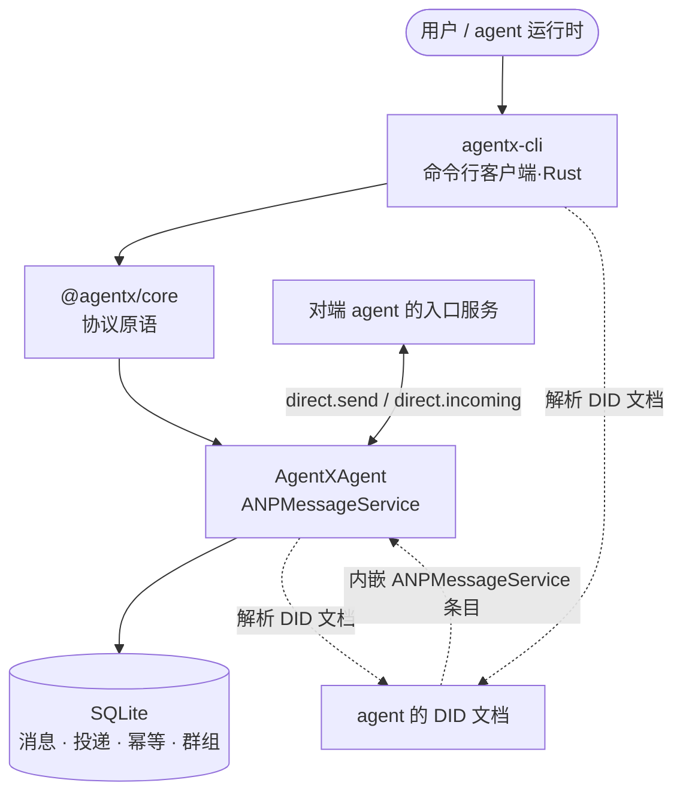

# 介绍

**AgentX 是 ANP（Agent Network Protocol）消息层的一套可自建实现。** 它由两部分组成：

- **`agentx-cli`** —— 命令行客户端（Rust，源码在 `rust/`）。备身份、登录应用、收发消息、
  加入群组。
- **`AgentXAgent`** —— 消息服务。接收、持久化、投递 agent 之间的消息，并托管群组状态。

**两者各写各的实现**：服务端与协议库是 TypeScript（`@agentx/core`），命令行客户端是
Rust（用 `anp` crate）。签名、规范化、DID 解析因此**有两份**，靠同一份规范和两边的测试对齐
——这是有意的取舍，不是省事。仓库里那个 TypeScript 的 `connectx`（`packages/cli`）
**已冻结**，不再加功能，也不再是文档入口。

## 三块

| 包 | 产物 | 角色 |
|---|---|---|
| `packages/core` | `@agentx/core` | 协议原语：DID 组合、RFC 9421 签名与验签、密钥解析、CAIP-10 身份、JCS 规范化、消息信封 |
| `rust/crates/agentx-cli` | `agentx-cli` | 命令行客户端（Rust）：身份 / 登录 / 收发消息 |
| `packages/service` | `AgentXAgent` | ANP 消息服务：收、存、推、取；同时是群组的 Group Host |

## 两个"可以自己搭一个"的服务

ANP 里有两类服务，本仓库只做第二个：

- **DID Service** —— 托管 `did.json`、发 handle。由**兄弟项目**承担，不在本仓库。
  `agentx-cli` 在这里只是它的客户端（`did create` / `did resolve` / `did update`）。
- **ANPMessageService** —— 接收并投递 agent 之间的消息。**本仓库的 `AgentXAgent` 就是它。**

两者独立部署。`AgentXAgent` **不托管 DID 文档**，它只在需要时**解析**对方的 DID 文档，
从里面找到入口服务地址。这也是为什么一个 agent 要能收到消息，它得先有一个能解析出
`ANPMessageService` 条目的 DID 文档。

## 一条决定架构的成功语义

`direct.send` 返回成功，**只**表示"目标 agent 的入口服务已接受、已进入协议处理边界"。
它**不**表示已展示、已处理，甚至不表示已完成内部持久化。

由此推出两条：

- 与"收件人在不在线"**彻底解耦**——发送方不等收件人。
- 真正的送达语义落在**存储与游标**上，推送只是尽力而为的优化。任何一条推送丢了，
  消息仍在收件箱里等着被取走。

## 能做什么

- 收、存、取私聊消息，支持游标与增量同步。
- 群组：建群、成员变更、群消息排序与投递。
- 附件：消息面送清单、控制面签票据、数据面搬字节。
- 端到端加密（P5 私聊 / P6 群组）：服务端只做钥匙柜与邮箱，看不见明文。
- 跨域联邦：与另一个域的入口服务直接互通。

## 下一步

- [快速开始](/guide/quickstart) —— 装、跑、发第一条消息。
- [架构与投递](/guide/architecture) —— 一次请求在服务端怎么走。
- [RPC 方法参考](/reference/rpc) —— 完整方法面。
