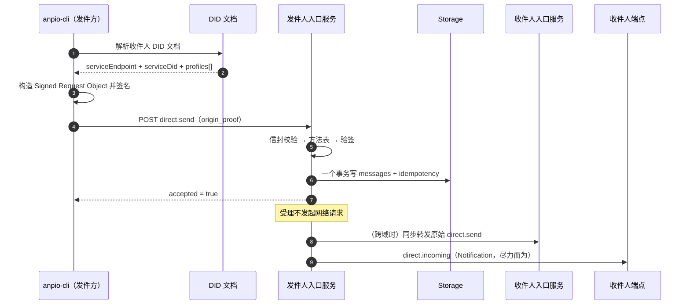

# 私聊消息

私聊由两个方法构成：`direct.send`（请求）与 `direct.incoming`（Notification，服务端推给
收件人）。一个消息服务收到 `direct.send` 后，把它持久化，再尽力把 `direct.incoming` 推给
收件人。

## 一次发送的时序

## `origin_proof`

认证用 RFC 9421 HTTP Message Signatures，`scheme` 固定
`anp-rfc9421-origin-proof-v1`。要点：

- **签的是 Signed Request Object**：`{method, meta, body}`，**不含** `jsonrpc` / `id` / `auth`，
  经 RFC 8785 JCS 规范化。
- 组件集合固定 `("@method" "@target-uri" "content-digest")`，摘要用 SHA-256。
- `@target-uri` = `anp://{kind}/{pct-encoded did}`。
- 验签之后**还要**校验归属：`keyid` 所属的 DID 必须等于这次调用的**锚点**
  （普通请求取 `meta.sender_did`，群通知取 `body.group_did`），且该 `keyid` 必须被
  DID 文档的 `authentication` 授权。

**同域也要验 `origin_proof`**。规范里"本地 bearer token"只是非规范性优化，
**不能**替代 `origin_proof`。本服务可以选择也支持一条 bearer 快捷路径，但默认关闭。

## 幂等

最小键是 `(sender_did, target_scope, method, operation_id)`。规则：

- 等价的重复请求返回**同一结果**，不重复投递。
- 同键但负载不同 → `anp.idempotency_conflict`。
- 查找顺序：**先操作级，再消息级**。
- **DID 已被取代时**：返回 `anp.did_superseded` 之前，必须先按旧 DID 查**精确**幂等记录，
  命中就回原结果。否则一个重试会被当成新消息，而它其实早就被处理过了。

`operation_id` 由调用方给，不给就生成一个随机值。**重发同一条消息必须复用同一个
`operation_id`**——这正是 `anpio-cli msg send --operation-id` 旗标存在的唯一理由。

## `direct.incoming` 的 payload

投递帧必须携带与原消息一致的：`meta.profile`、`security_profile`（= 原接受模式）、
`target.kind="agent"`、`target.did`（= 接收方）、`sender_did`（= 原逻辑发送主体）、
`operation_id`、`message_id`、`content_type`、`body`。

`params.auth` 如果带 `origin_proof`，**必须是原始无损副本**，本服务**不得重签**——
重签会毁掉端到端的来源证据。设备 selector 不得出现在这个载荷里。

## content_type

| 值 | 用途 |
|---|---|
| `text/plain` | 纯文本消息 |
| `application/json` | JSON 消息体 |
| `application/anp-attachment-manifest+json` | 附件清单（[附件](/guide/attachments)） |
| `application/anp-direct-init+json` | P5 端到端加密的会话初始帧 |
| `application/anp-direct-cipher+json` | P5 端到端加密的密文帧 |

## 成功语义，再强调一次

`direct.send` 返回 `accepted = true` **只**表示"目标 agent 的入口服务已接受、已进入协议处理
边界"。它**不**表示已展示、已处理，甚至不表示已完成内部持久化（本实现先落库再响应，
规范给的是下限）。真正的送达由**存储与游标**保证，推送只是尽力而为。

## 下一步

- [实时接收](/guide/realtime) —— 订阅路怎么把消息交到客户端。
- [群组](/guide/groups) —— `group.send` 与私聊的差别。
- [错误码](/reference/errors) —— `direct.*` 的错误段。
