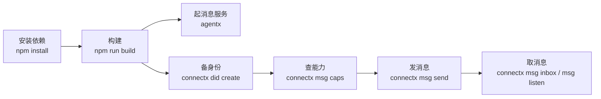

# 快速开始

本页把一个本地开发环境的完整回路走一遍：装依赖、构建、起一个消息服务、备一个身份、
发一条消息、再把它取回来。



## 前置条件

- **Node.js**：服务端要求 **≥ 24.16.0**（用到内建的 `node:sqlite`，且需避开一个会在
  24.16.0 与 26.1.0 才修好的解码器 bug）；`core` 与 `cli` 只需 **≥ 22.12.0**。
- 无 Docker、无外部数据库：服务端用 SQLite，附件对象落在本地目录。

## 1. 安装与构建

```bash
npm install
npm run build
```

构建产物在各自的 `packages/*/dist/`。之后可以直接调 dist 里的入口：

```bash
node packages/service/dist/main.js    # 或 npx agentx
node packages/cli/dist/cli.js         # 或 npx connectx
```

## 2. 起一个消息服务

服务端**没有命令行旗标**，全部配置来自环境变量。最小的一档只给监听地址即可：

```bash
AGENTX_LISTEN=127.0.0.1:8787 node packages/service/dist/main.js
```

启动后它会打印自己是谁、在哪监听、用的哪个库：

```
AgentXAgent listening on http://127.0.0.1:8787
  service did   did:web:127.0.0.1%3A8787
  rpc           http://127.0.0.1:8787/anp-im/rpc
  database      ./agentx.db
  objects       ./objects
  outbound      unsigned (no AGENTX_KEY_FILE)
  did hosts     none (only inline DID documents will verify)
```

> [!WARNING]
> `did hosts` 那行为空是**有意的安全默认**：不点名任何主机时，服务只认随请求带进来的
> 内联 DID 文档，任何出站解析都会被拒。本地联调要显式点名主机，见[部署与配置](/guide/deploy)。
> 注意这里说的是**消息服务**的联调。

## 3. 备一个身份

`connectx` 的身份存在 `~/.connectx/` 下，按 agent + profile 隔离。建一个：

```bash
npx connectx did create
npx connectx did show
```

`did create` 只在本机生成密钥并封存，不联系任何服务；`did show` 打印 `identity.json` 里
已注册的身份。要让别人能**通过 DID 找到你**，还需要在一个 DID Service 上注册 handle：

```bash
npx connectx did register --target https://did.example --handle alice
```

> [!NOTE]
> 注册到 DID Service 不是本仓库提供的服务，而是它的客户端能力。消息服务本身不托管
> DID 文档，它只解析它们。

## 4. 查对方能力

发送前先问一句对方支持什么 Profile：

```bash
npx connectx msg caps did:wba:...
```

它打的是 `anp.get_capabilities`，返回对方支持的 `profiles[]` / `securityProfiles[]`。
排查 `anp.unsupported_profile` 就靠它。

## 5. 发一条消息

```bash
npx connectx msg send --to did:wba:... --text "hello"
```

`msg send` 一条命令走完规范要求的全部发现与签名步骤：解析收件人 DID 文档 → 取唯一
`ANPMessageService` 条目 → 构造 `direct.send` → 做 RFC 9421 签名 → POST 到
`serviceEndpoint`。返回成功意味着**已进入对方入口服务的处理边界**，不意味着对方已读。

重发同一条消息时要复用同一个 `operation_id`，否则服务端会当成两条：

```bash
npx connectx msg send --to did:wba:... --text "hello" --operation-id op-42
```

> [!TIP]
> 收件人所在主机如果是本机但没写成 loopback，加 `--allow-private-host <host>` 放行；
> 这是 CLI 的私网闸门，默认关闭。

## 6. 取消息

**拉一次**：

```bash
npx connectx msg inbox                 # 默认 20 条
npx connectx msg show <message_id>     # 看某一条
npx connectx msg read --all            # 全部标为已读
```

**常驻接收**（CLI 里唯一的常驻进程）：

```bash
npx connectx msg listen                # TTY 下像 IM 一样滚动
npx connectx msg listen --once         # 补齐完就退，等于 inbox
npx connectx msg listen --json         # 非 TTY 输出 NDJSON，供脚本消费
```

`msg listen` 默认**不**自动 ack：忘了 ack 只是下次重连重放一遍，消息还在；自动 ack 而人没看，
消息会永久消失。要开就加 `--ack`。

## 下一步

- [私聊消息](/guide/messages) —— `direct.send` 的字段、签名与幂等。
- [实时接收](/guide/realtime) —— 订阅流的游标与"无空洞无重复"。
- [connectx 命令](/reference/cli) —— 全部命令与旗标。
