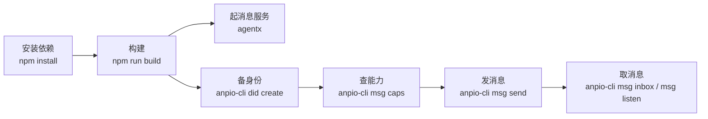

# 快速开始

本页把一个本地开发环境的完整回路走一遍：装依赖、构建、起一个消息服务、备一个身份、
发一条消息、再把它取回来。



## 前置条件

- **Node.js**：服务端要求 **≥ 24.16.0**（用到内建的 `node:sqlite`，且需避开一个会在
  24.16.0 与 26.1.0 才修好的解码器 bug）；`core` 只需 **≥ 22.12.0**。
- **Rust**：命令行客户端是 Rust 的，版本下限以 `rust/Cargo.toml` 的 `rust-version` 为准。
- 无 Docker、无外部数据库：服务端用 SQLite，附件对象落在本地目录。

## 1. 安装与构建

消息服务与协议库是 Node 的：

```bash
npm install
npm run build
```

构建产物在各自的 `packages/*/dist/`。之后可以直接调 dist 里的入口（工作区装好后
`node_modules/.bin` 里也有同名可执行文件）：

```bash
node packages/service/dist/main.js    # 或 npx agentx
```

命令行客户端**是另一件东西**，源码在 `rust/`，二进制叫 `anpio-cli`：

```bash
cargo build --release --manifest-path rust/Cargo.toml
```

> [!NOTE]
> `anpio-cli` **没有发布到任何包管理器**——crates.io 上的 `anpio-cli` 是**另一个项目**，
> 所以**不要**写 `cargo install anpio-cli`。只能像上面那样从源码构建，产物在
> `rust/target/release/anpio-cli`。下文一律简写成 `anpio-cli`，你可以把它加进 `PATH`，
> 或者直接敲全路径。

## 2. 起一个消息服务

服务端**没有命令行旗标**，全部配置来自环境变量。最小的一档只给监听地址即可：

```bash
AGENTX_LISTEN=127.0.0.1:8787 node packages/service/dist/main.js
```

启动后它会打印自己是谁、在哪监听、用的哪个库：

```
AgentXAgent listening on http://127.0.0.1:8787
  service did   did:web:127.0.0.1%3A8787
  rpc           http://127.0.0.1:8787/anp-im/rpc
  database      ./agentx.db
  objects       ./objects
  outbound      unsigned (no AGENTX_KEY_FILE)
  did hosts     none (only inline DID documents will verify)
```

> [!WARNING]
> `did hosts` 那行为空是**有意的安全默认**：不点名任何主机时，服务只认随请求带进来的
> 内联 DID 文档，任何出站解析都会被拒。本地联调要显式点名主机，见[部署与配置](/guide/deploy)。
> 注意这里说的是**消息服务**的联调。

## 3. 备一个身份

`anpio-cli` 的身份存在自己的 store 根下（`$ANPIOCLI_HOME`，缺省 `~/.anpio-cli`），
按 agent + profile 隔离。它**不碰**旧 `connectx` 的 `~/.connectx/`。建一个：

```bash
anpio-cli did create --host http://localhost:8000 --handle alice
anpio-cli did show
```

`did create` 在本机生成密钥，**并顺手把 DID 文档注册到 `--host`**——DID 文档只有在服务够得着
的地方才有意义。注册失败时它会明说，而不是留下一个本机有、外面查不到的身份。

> [!NOTE]
> `--host` 要的是一台 **DID 主机**（`awiki-open-server` 那条线），不是第 2 步那个**消息服务**
> ——消息服务本身不托管 DID 文档，它只解析它们。改了文档之后要重新发布：`anpio-cli did register`
> 重新发到已知的主机；`anpio-cli did publish` 走主机的认证控制面，只推送变化的那一份。

## 4. 查对方能力

发送前先问一句对方支持什么 Profile：

```bash
anpio-cli msg caps did:wba:...
```

它打的是 `anp.get_capabilities`，返回对方支持的 `profiles[]` / `securityProfiles[]`。
排查 `anp.unsupported_profile` 就靠它。

## 5. 发一条消息

```bash
anpio-cli msg send --to did:wba:... --text "hello"
```

`msg send` 一条命令走完规范要求的全部发现与签名步骤：解析收件人 DID 文档 → 取唯一
`ANPMessageService` 条目 → 构造 `direct.send` → 做 RFC 9421 签名 → POST 到
`serviceEndpoint`。返回成功意味着**已进入对方入口服务的处理边界**，不意味着对方已读。

`--to` 既收 DID，也收通讯录里的**名字**（`anpio-cli contacts`）：一个名字若被两条联系人都
认，它会**拒绝**而不是猜。

重发同一条消息时要复用同一个 `operation_id`，否则服务端会当成两条：

```bash
anpio-cli msg send --to did:wba:... --text "hello" --operation-id op-42
```

> [!TIP]
> 收件人所在主机如果是本机但没写成 loopback，加 `--allow-private-host <host>` 放行；
> 这是 CLI 的私网闸门，默认关闭。

## 6. 取消息

**拉一次**：

```bash
anpio-cli msg inbox                 # 默认 20 条
anpio-cli msg show <message_id>     # 看某一条
anpio-cli msg read --all            # 全部标为已读
```

**常驻接收**（CLI 里唯一的常驻进程）：

```bash
anpio-cli msg listen                # TTY 下像 IM 一样滚动
anpio-cli msg listen --once         # 补齐完就退，等于 inbox
anpio-cli msg listen --json         # 非 TTY 输出 NDJSON，供脚本消费
```

`msg listen` 默认**不**自动 ack：忘了 ack 只是下次重连重放一遍，消息还在；自动 ack 而人没看，
消息会永久消失。要开就加 `--ack`。

它还会把消费到的每一条写进本机的消息库
（`$ANPIOCLI_HOME/<agent>/<profile>/messages.db`）——E2EE 群消息的**明文**只在这里留得下来，
服务端没有。那份库**是内容、不是密钥**，但按本项目的规矩当密钥对待：文件 `0600`、没有导出
命令、**备份它等于备份聊天内容**。

## 下一步

- [私聊消息](/guide/messages) —— `direct.send` 的字段、签名与幂等。
- [实时接收](/guide/realtime) —— 订阅流的游标与"无空洞无重复"。
- [anpio-cli 命令](/reference/cli) —— 全部命令与旗标。

