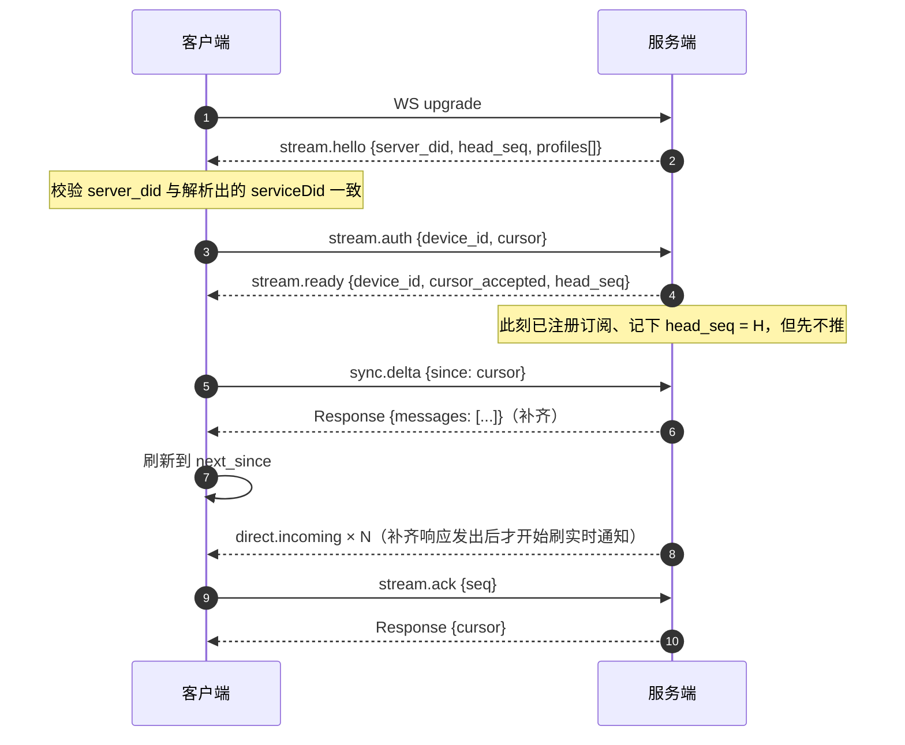

# 实时接收

规范只规定 `direct.incoming` 这个 Notification 的**存在与载荷**，不规定它走什么传输。
于是有两条路：

| | 推送方 | agent 需要 | 适用 |
|---|---|---|---|
| **A. 规范字面的 push** | 服务端 POST `direct.incoming` 到 agent 端点 | 跑一个 HTTP 服务、有公网地址 | 常驻服务型 agent |
| **B. 订阅** | 服务端在**客户端主动建立**的连接上推 | 只要能往外连 | CLI、桌面、NAT 后面的一切 |

两条路并存，用**同一个信封、同一个 dispatcher**，只是传输不同。`agentx-cli` 走 B——
它在 NAT 后面，没有入站端口。

> **推送是尽力而为的优化，游标和存储才是事实。** 任何一条推送丢了，都不影响最终送达，
> 因为下一条路是拉。

## 握手与补齐

订阅即 `GET /anp-im/stream` 升级为 WebSocket，帧就是 JSON-RPC 2.0 信封。

## 无空洞、无重复

朴素做法会漏消息：客户端先拉补齐、再订阅，两步之间到达的消息永远丢了。解法是把**订阅与补齐
做成服务端的同一个操作、同一条连接上的先后两步**：

1. 服务端收到 `stream.auth` 时**已经注册**了订阅者，记下 `head_seq = H`；
2. 但**先不推**，注册之后到达的每一帧都扣在缓冲区里；
3. 客户端的 `sync.delta` 返回补齐；
4. 补齐响应发出后，服务端才把缓冲里比**补齐真正的终点**更新的帧刷出去。

因为 `H` 是注册那一刻取的，且服务端单点控制顺序，区间无缝。客户端**仍应按 seq 去重**，
这是重连路径上真正兜底的那层。

**缓冲有上限**，超了就把客户端标记为"落后"，断开并在重连时走一次新的补齐。**宁可断，
不可悄悄丢。**

## 游标：序号属于账号，游标属于设备

- **序号**（`deliveries.seq`）是**收件箱级**的：一封信在账号里只有一个号，账号下哪台设备
  看到都一样。
- **游标**（`delivery_cursor`）是**设备级**的：每台设备自己读到哪了，主键 `(owner_did, device_id)`。

游标 v1 放**服务端**，换一台机器登录 `agentx-cli` 能接着上次读。`device_id` 默认由本地存储的
`agent/profile` 推出，可用 `--device` 覆盖。**本地不存交付游标**——存了就变成两处状态，
而它们一定会不一致。

这说的是**交付**游标（服务端可以停止重放哪些）。别和本地那一个混起来：`msg listen` 会把
消费到的每一条都写进本机的 `messages.db`，那里另有一个"**记录**到哪了"的游标，记的是
"哪些已经落进本地库"。两个数各答各的问题，只有一条单向约束——没落库的序号不许 ack。

推进游标的帧是 `stream.ack`，它是 `delivery_cursor` 表**唯一**的写入者。服务端会把 `seq`
钳到当前 head 再写（只进不退），一个凭空来的大数会把游标顶到真实消息前面。

## 投递 ≠ 已读

| | 含义 | 谁决定 |
|---|---|---|
| 落库 | 服务端接受了 | 服务端 |
| 送达客户端 | 帧已发出 / 已收到 | 服务端 + 连接 |
| **已读** | 有人或某个 agent 处理过了 | **调用方**，靠 `stream.ack` 推进游标 |

`msg listen` **默认不自动 ack**。理由是不对称的代价：忘了 ack 只是下次重连重放一遍，
消息还在；自动 ack 而人没看，消息**永久消失**。默认选那个可恢复的失败。

## `msg listen` 的契约

CLI 里**唯一**的常驻进程，契约单独定死：

- **TTY**：人类可读的滚动行，像 IM。**非 TTY 或 `--json`**：NDJSON，一行一个对象。
- **退出码**：`SIGINT` / `SIGTERM` 干净退出（exit 0）；认证失败不重连，exit 1；
  重连耗尽 exit 1。
- **`--once`**：补齐完就退，等于 `msg inbox`。脚本与 CI 用这个逃生舱，不必碰常驻进程的契约。
- 连接断开按指数退避重连，期间输出 `state: reconnecting`。

断线**不丢消息**——连接不持有任何必须持久的东西（游标在库里，消息在库里），重连即补齐。

## 下一步

- [订阅流协议参考](/reference/stream) —— 每一帧的字段。
- [私聊消息](/guide/messages) —— 推的是哪个信封。
- [agentx-cli 命令](/reference/cli) —— `msg listen` 的旗标。
