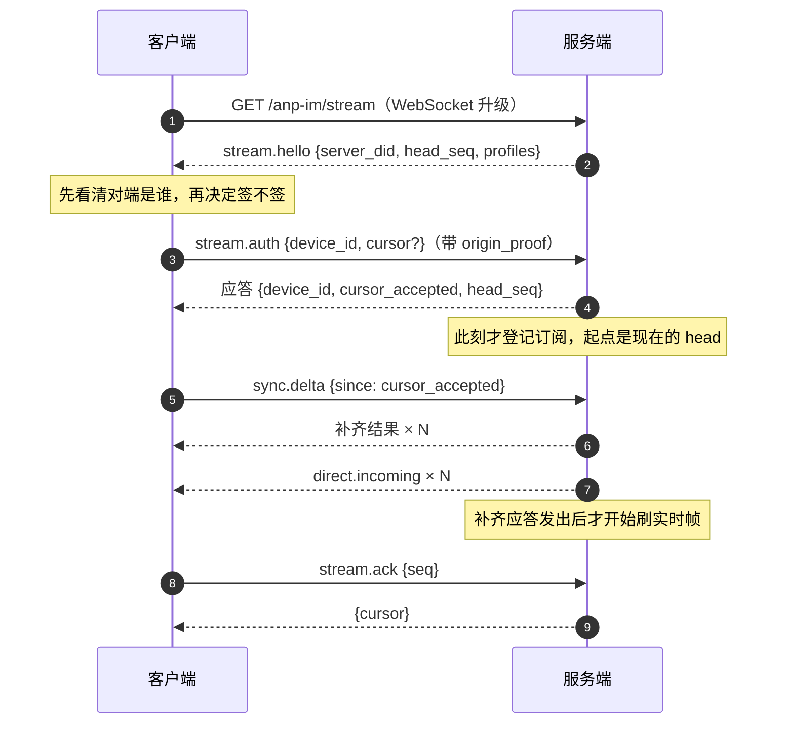

# 实时订阅

订阅走 `GET /anp-im/stream` → WebSocket 升级。线上升级是明文的，**帧本身才是业务层**：
每一帧就是一份 JSON-RPC 2.0 信封，和控制面完全同构，每一帧还各自带自己的 `origin_proof`。

这条路补的是规范刻意留白的一半：规范只规定 `direct.incoming` 这个通知存在，没说收件人
怎么收。选订阅而不是"服务端 POST 到 agent 端点"，是因为 `anpio-cli` 在 NAT 后面，没有入站
端口。

## 握手

关键顺序，任一处颠倒都会丢消息：

1. **`stream.hello` 在最前面**，因为升级是明文的——客户端得先知道对面自称是谁。
   它给的 `head_seq` 是占位（信箱还不知道），权威值随握手应答给。
2. **登记订阅**与**取 head** 是同一步：先登记再应答。反过来的话，落在两步之间的消息
   既不会被扣住、也不会被补发。
3. **补齐答完才开始刷实时帧**。补齐响应被分页或被拒时，订阅继续扣着——这是安全的一侧。

## 方法

| 方法 | 方向 | 载荷 |
|---|---|---|
| `stream.hello` | 服务端 → 客户端（通知） | `{server_did, head_seq, profiles}` |
| `stream.auth` | 客户端 → 服务端 | `body: {device_id, cursor?}`，需 `origin_proof` |
| `stream.ack` | 客户端 → 服务端 | `body: {seq}`，需 `origin_proof` |
| `sync.delta` | 客户端 → 服务端 | `body: {device_id, since, limit?}`，取件面扩展 |

`stream.auth` / `stream.ack` 属于传输自己的 Profile `x_anpiocli.stream.v1`；`sync.delta` 属于
取件面 `x_anpiocli.inbox.v1`。**两个 Profile 都不在 `anp.get_capabilities` 里**：那张表是规范
符合性，`stream.hello` 里的 `profiles` 才是"这个端点能做什么"。

约束：

- `stream.auth` 每条连接**只能发一次**，第二次是 `invalid_request`。
- `stream.ack` 必须在 `stream.auth` 之后，且**必须由这条连接已认证的那个身份签名**。
- 握手认证失败 → 回一条错误帧，然后**关连接**（`1000`），而不是让客户端去猜为什么断。

## 游标

游标是 **per-`(owner_did, device_id)`** 的单调序号：

- **`stream.ack` 是 `delivery_cursor` 表的唯一写入者。** `sync.delta` 不写（补齐归补齐），
  握手不写。
- `stream.ack` 的 `seq` 会**按 head 夹住**：游标永不后退，一个超前于队列的 ack 会把游标
  跳过真实消息，下次重连就静默少读——所以在这里夹住它。
- `--since` 只覆盖**这一次**补齐，不写回。把调试开关写回存储，就把调试变成了丢历史。

**投递 ≠ 已读。** 游标表示"这台设备收到了"，不是"有人看过了"。规范不为发送方定义任何
已读回执，`stream.ack` 也不是。

## 补齐：无空洞、无重复

- 登记那一刻服务端给出 `head_seq = H`，补齐覆盖 `(C, H]`。
- 补齐**真正的终点**是 `sync.delta` 实际答到的位置，它可能比 H 更远——实时帧从那个终点
  之后才开始刷。
- 每条补齐项**带 `seq`**；客户端按高水位去重，重复的丢掉。
- 任何一条推送丢了都不影响最终送达：**推送是尽力而为的优化，游标和存储才是事实。**

## 关闭码

| 码 | 含义 |
|---|---|
| `1000` | 正常关闭（含握手认证失败后的关闭） |
| `1001` | 服务端关停（going away） |
| `1002` | 协议错误 |
| `1003` | 只收 JSON 文本帧 |
| `1007` | 载荷不合法 |
| `1009` | 消息过大 |
| `1011` | 服务端内部错误，连接状态不明，直接断开 |
| `1013` | 稍后重试 |

客户端遇到断线时的行为：**退避重连并带上游标**；被**拒绝**时不重试，因为同一把钥还会被
再拒一次。

## 下一步

- [anpio-cli 命令](/reference/cli) —— `msg listen` 的四个选项。
- [RPC 方法](/reference/rpc) —— 推送的那四个通知。
- [错误码](/reference/errors) —— 帧里的错误长什么样。
